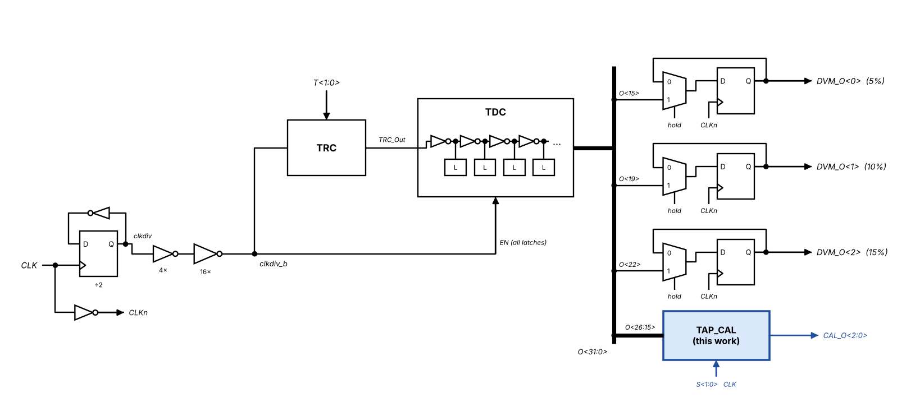
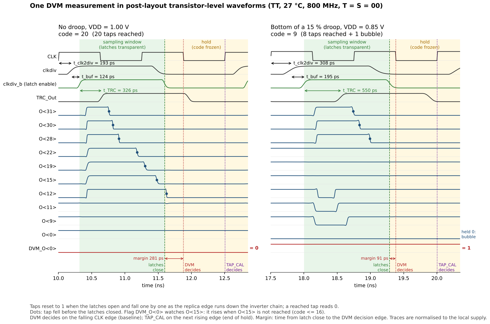

# All-Digital Supply-Droop Detector with Corner-Calibrated Thresholds

**A transistor-level, post-layout implementation of Bowman *et al.*'s all-digital dynamic variation monitor (DVM) in a generic 45-nm process, extended with TAP_CAL, a small per-die calibration block that removes every no-droop false alarm across process–temperature corners.**


[](https://github.com/Vignesh-GMAXX/DVM-Supply-Droop-Detector/actions/workflows/reproduce-figures.yml)

IISc Bengaluru · Digital VLSI Design (DVLSI) 2026 · Group P1G11 · **Patel Krish Badal, Govindu Vignesh**

📄 **[Final report (PDF)](report/P1G11_FinalReport.pdf)** · 📚 **[Documentation](docs/README.md)** · 📊 [Results](docs/06-results.md) · 🌡️ [Corners and calibration](docs/07-pvt-and-calibration.md) · ❓ [FAQ](docs/10-faq.md)

---

## At a glance

| | Post-layout result (TT, 27 °C, 1.0 V, 800 MHz) |
|---|---|
| Detects | 5 / 10 / 15 % supply droops as three flags, in **1.9–4.5 ns** |
| Shortest flagged droop | **1 ns** FWHM at 10 % and 15 %, 2 ns at 5 % (best sampling phase) |
| Resolution | **13.3 mV per code**, DNL −0.81 / +0.89 LSB, INL −0.89 / +0.08 LSB |
| Power, energy | **138.4 µW**, **173 fJ per cycle**, 5.7 nW leakage |
| Area | **659 µm²** (36.17 × 18.21 µm), DRC clean, LVS matched, RC extracted |
| Needs | only the clock: no reference voltage, no analog bias |
| Simulated | transistor level throughout; the only behavioural (Verilog-A) block is the test-bench droop source |
| 15 PVT corners | fixed thresholds: 41 / 60 correct, false alarms at 6 / 15 corners. **TAP_CAL: 50 / 60 correct, 0 / 15 corners with a false alarm** |
| Monte Carlo | 100 / 100 samples without a false flag, 4.3σ margin; 94 % of the replica's variance is global |

---

## How it works

<p align="center"></p>

1. A **÷2 divider** and a 4× + 16× **clock buffer** make `clkdiv_b`: high for one clock period (the *sampling window*), low for the next (*hold*). One measurement every 2.5 ns.
2. When the window opens, a **tunable replica circuit (TRC)**, trimmed by `T<1:0>`, launches an edge whose delay tracks the supply like real logic.
3. A **32-stage latch-based time-to-digital converter (TDC)** records how far that edge gets before the window closes. A drooped supply slows every stage, so fewer taps are reached: the code drops from **20** to 16, 12 and 9 at 5, 10 and 15 % droop.
4. Three **decision stages** read taps `O<15>`, `O<19>`, `O<22>` during the hold phase and raise `DVM_O<0:2>`.
5. **TAP_CAL** (our addition) picks those taps per die with `S<1:0>` and samples at the end of the hold phase.

<p align="center"></p>
<p align="center"><sub><b>One measurement in post-layout waveforms.</b> Left: no droop, 20 taps reached. Right: bottom of a 15 % droop: every delay grows, only 8 taps are reached, and the margin between the latches closing and the DVM's decision shrinks from 281 to 91 ps. <a href="docs/02-architecture.md">Full explanation →</a></sub></p>

The whole measurement in three equations (report eqs. 1, 2 and 4):

```text
code    = floor( (T_w − t_TRC) / t_s )        (1278 − 326) / 47.6 = 20 at TT
Δcode  ≈ −δ · T_w / t_s                        a slow-down δ costs ≈ 27·δ codes
flag_k  = 1  ⇔  code ≤ 31 − k                  taps 15 / 19 / 22 → codes 16 / 12 / 9
```

---

## The problem TAP_CAL solves

A delay sensor cannot tell a drooped supply from a slow die. Across 15 process–temperature corners the **no-droop** code moves from 9 to 28, while a 15 % droop moves it by only 11. With fixed thresholds, six corners raise flags with no droop at all.

<p align="center"></p>

TAP_CAL is a separate block next to the unchanged DVM: three 4:1 muxes choose, per die, which TDC taps drive the flags (`S<1:0>`, set from one no-droop reading), and its flip-flops sample at the end of the hold phase, which also removed a timing race found at the slowest corner.

| 60 corner–droop cases | Fixed thresholds (DVM) | TAP_CAL |
|---|---|---|
| Graded correctly | 41 | **50** |
| False warnings | 16 | **4** (10 % over-graded at slow and hot corners) |
| Corners with a flag and no droop | 6 of 15 | **0 of 15** |
| Cost | – | ≈ 11 µW (6 %), +0.5 ns latency |

Why each corner behaves as it does: [7. PVT corners and calibration](docs/07-pvt-and-calibration.md).

---

## Results

<table>
<tr>
<td width="50%"><br><sub><b>Transfer curve</b>: code vs. static supply (2.5-mV steps), DNL and INL per code.</sub></td>
<td width="50%"><br><sub><b>Recovering the post-layout design</b>: wiring slowed the TDC stage 1.75×; a clock buffer, 800 MHz and re-selected taps restored correct flags.</sub></td>
</tr>
</table>

<p align="center"><br>
<sub><b>Droop response</b>: 5 / 10 / 15 % droops raise one, two and three flags, 1.9–4.5 ns after the droop starts.</sub></p>

<table>
<tr>
<td width="42%"><br><sub><b>Inside the TDC</b>: all 32 taps in one window at the droop bottom; the code shrinks 20 → 16 → 12 → 9.</sub></td>
<td width="58%"><br><sub><b>Detection map</b>: 40 Gaussian droops in one transient. From 8 ns every droop is graded correctly; shorter ones are graded one level low or depend on the sampling phase.</sub></td>
</tr>
</table>

<p align="center"><br>
<sub><b>Droop trains</b>: six back-to-back droops. At ff 125 °C the fixed-threshold DVM's 5 % flag never clears; TAP_CAL grades every event correctly.</sub></p>

<p align="center"><br>
<sub><b>Monte Carlo</b> (schematic, 100 samples): process + mismatch (blue) and mismatch only (red).</sub></p>

<p align="center"><br>
<sub><b>DVM layout</b>, 36.17 × 18.21 µm: clock buffer on top, divider and decision stages below it, the TDC in the middle, the TRC along the bottom.</sub></p>

All figures of merit, the 15-corner table, Monte Carlo statistics and a comparison with seven published monitors: **[6. Results](docs/06-results.md)**.

---

## Documentation

| # | Chapter | |
|---|---|---|
| 1 | [Background](docs/01-background.md) | supply droops, monitor families, Bowman's DVM, objectives |
| 2 | [Architecture and theory](docs/02-architecture.md) | clocking, replica, TDC, code, equations, decision stages, TAP_CAL, timing budget |
| 3 | [Circuits and cells](docs/03-circuits-and-cells.md) | sizing, every cell and block with schematic and layout, pins, test-bench hierarchy |
| 4 | [Layout and extraction](docs/04-layout-and-extraction.md) | floorplan, DRC/LVS/PEX flow, what extraction changed |
| 5 | [Simulation setup](docs/05-simulation-setup.md) | test bench, droop stimuli, every measurement expression, saved states, rebuild guide, pitfalls |
| 6 | [Results](docs/06-results.md) | transfer curve, latency, short droops, trains, detection map, power, FoMs, comparison |
| 7 | [PVT corners and calibration](docs/07-pvt-and-calibration.md) | 15 corners, why fixed thresholds fail, TAP_CAL, calibration procedure |
| 8 | [Monte Carlo](docs/08-monte-carlo.md) | false-alarm margin, global vs. local variation |
| 9 | [Design journey](docs/09-design-journey.md) | what broke, how it was found and fixed, lessons learned |
| 10 | [FAQ](docs/10-faq.md) | ~35 questions and short answers |
| – | [Glossary](docs/glossary.md) | signals, symbols, metrics, tools |

---

## Repository layout

```text
.
├── README.md                  you are here
├── report/
│   ├── P1G11_FinalReport.pdf  final report (IEEE format, 11 pages)
│   └── latex/                 its LaTeX source, figures and refs.bib
├── docs/                      documentation (chapters 1–10, glossary)
│   ├── figures/               data figures (generated by scripts/)
│   └── images/                Cadence schematic and layout screenshots
├── diagrams/                  block diagrams as editable draw.io files
│   ├── previews/              PNG previews
│   └── generator/             Python that draws them
├── veriloga/                  supply-droop sources (test bench only)
├── scripts/                   figure scripts, data parsers, reproduce_figures.sh
├── data/                      exported simulation results used by the scripts
├── .github/workflows/         CI: regenerates every figure and checks the links on each push
├── CITATION.cff               citation metadata
└── LICENSE                    MIT (code)
```

---

## Reproducing the figures

No simulator is needed: every data figure is regenerated from the exported results in [`data/`](data).

```bash
pip install -r scripts/requirements.txt   # numpy, pandas, matplotlib
bash scripts/reproduce_figures.sh         # → build/figures/fig_*.png and .pdf (about 30 s)
```

The regenerated report figures render identically to those in the report, and GitHub Actions repeats the whole run on every push. What each script draws and reads: [`scripts/README.md`](scripts/README.md); what each data file holds: [`data/README.md`](data/README.md).

## Reproducing the simulations

The design lives in a Cadence Virtuoso library whose top cell `DVM_TOP` holds only the test bench and the design under test (DVM + TAP_CAL); a `config` view binds both to their extracted views. Eight saved ADE L states reproduce every post-layout and worst-corner figure of merit; corners, droop trains, the detection map and Monte Carlo ran in ADE XL. [5. Simulation setup](docs/05-simulation-setup.md) documents the test bench, every variable and measurement expression, and how to rebuild the setup step by step. The droop sources are in [`veriloga/`](veriloga).

The PDK, the Cadence library, netlists and extracted views are not included (course and PDK licence terms).

---

## Limitations

- At hot corners TAP_CAL resolves only one level reliably (the TDC aliases beyond 5 %), and ss 125 °C is disabled.
- ff −40 °C reads code 28 even with the maximum trim, so 5 % and 10 % droops are missed there.
- Droops shorter than about 8 ns are graded one level low, because the thresholds sit exactly on the nominal codes.
- Alternating 60 / 28-ps stage delays give a DNL of up to −0.81 LSB.
- Monte Carlo was run on the schematic; all results are simulation, not silicon.

Details and possible fixes: [6. Results → Limitations](docs/06-results.md#limitations) and [9. Design journey](docs/09-design-journey.md#if-we-continued).

---

## How to cite

```bibtex
@techreport{p1g11_dvm_2026,
  author      = {Patel, Krish Badal and Govindu, Vignesh},
  title       = {Supply-Droop Detection With an All-Digital Dynamic Variation Monitor and Corner-Calibrated Thresholds},
  institution = {Indian Institute of Science, Bengaluru},
  type        = {DVLSI 2026 course project report, Group P1G11},
  year        = {2026},
  url         = {https://github.com/Vignesh-GMAXX/DVM-Supply-Droop-Detector}
}
```

GitHub's "Cite this repository" button uses [`CITATION.cff`](CITATION.cff).

## References

The design follows:

- K. A. Bowman *et al.*, "All-digital circuit-level dynamic variation monitor for silicon debug and adaptive clock control," *IEEE Trans. Circuits Syst. I*, 2011.
- K. A. Bowman *et al.*, "Dynamic variation monitor for measuring the impact of voltage droops on microprocessor clock frequency," *IEEE CICC*, 2010.

The full list (12 works) is in the report; the comparison with seven of them is in [6. Results](docs/06-results.md#comparison-with-published-supply-droop-monitors).

## Acknowledgments and AI use

We thank Prof. Viveka, the DVLSI 2026 instructor, and the teaching assistants Sisir Mridha and Samudrala Hareesh at IISc for their guidance. An AI assistant (Claude, Anthropic) was used for guidance on simulation planning, result interpretation, report drafting, the figure scripts and this documentation; all design, layout and simulation work was done by the authors (report, Appendix B).

## License

The code in this repository (scripts, diagram generator, Verilog-A sources) is released under the [MIT License](LICENSE). The report, documentation and figures may be shared with attribution; please cite the report.
