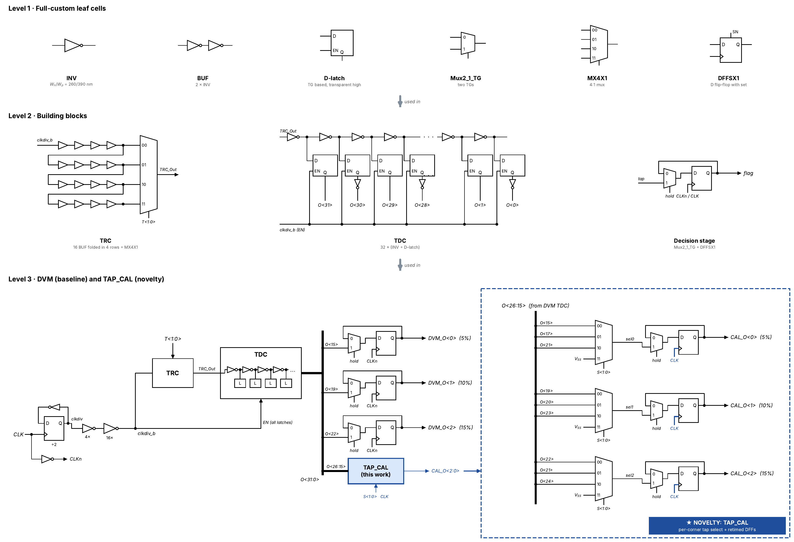
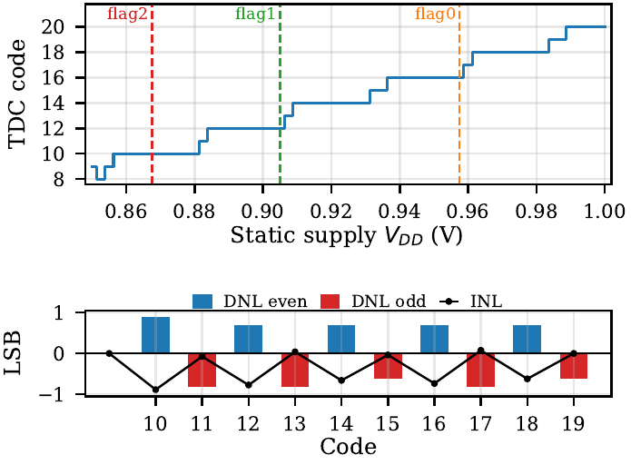
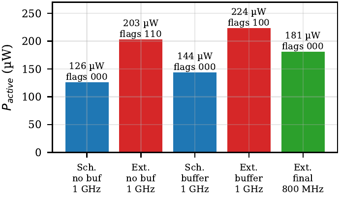
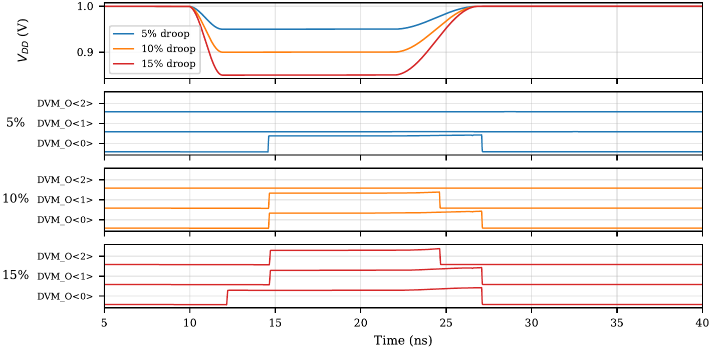
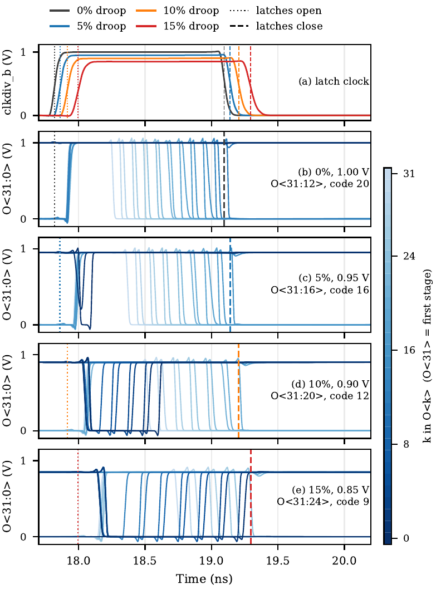
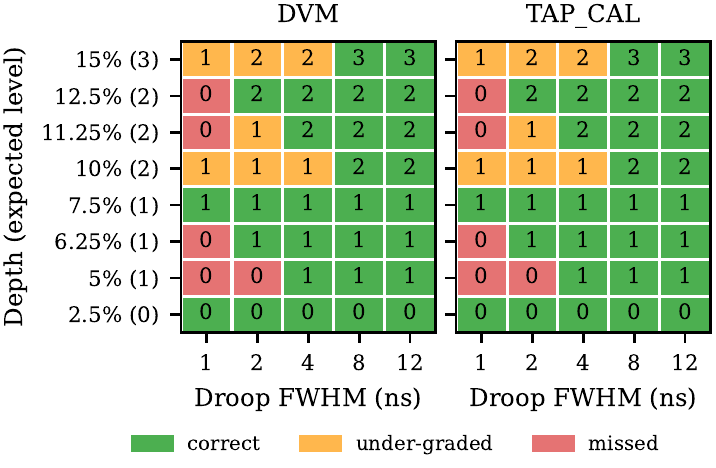
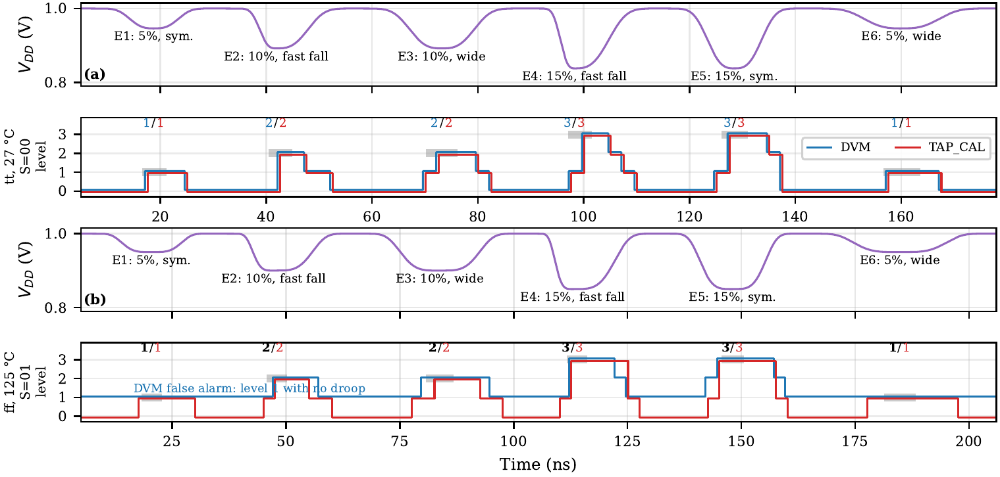
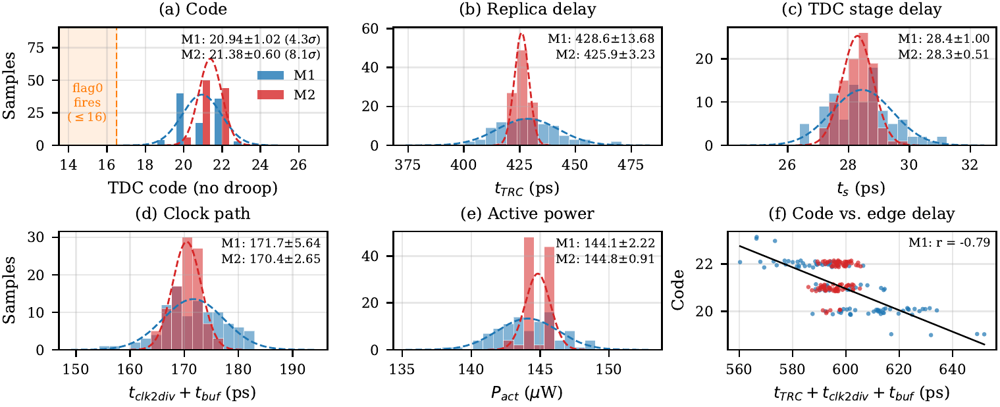
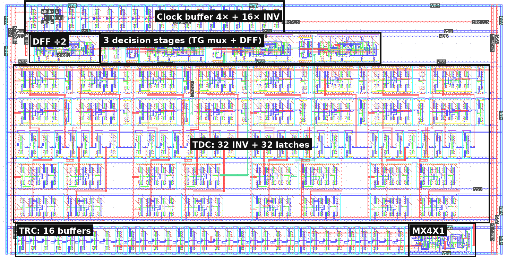

# All-Digital Supply-Droop Detector with Corner-Calibrated Thresholds

**Transistor-level, post-layout implementation of the Bowman et al. all-digital dynamic variation monitor (DVM) in a generic 45-nm process, extended with TAP_CAL, a per-die tap-calibration block that removes all no-droop false alarms across process–temperature corners.**

IISc Bengaluru · Digital VLSI Design (DVLSI) 2026 · Group P1G11 · Patel Krish Badal, Govindu Vignesh

📄 **[Final report (PDF)](report/P1G11_FinalReport.pdf)** · [Results](docs/RESULTS.md) · [Simulation set-up](docs/SIMULATION.md)

---

## Highlights

| Metric | Post-layout result |
|---|---|
| Process / clock | gpdk045 (45 nm), 1.0 V, 800 MHz, full-custom cells |
| Detection | 5 / 10 / 15 % droops, flagged in **1.9–4.5 ns**, as short as **1–2 ns** FWHM |
| Resolution | **13.3 mV/LSB**, DNL −0.81/+0.89 LSB, INL −0.89/+0.08 LSB |
| Power / energy | **138 µW** active, **173 fJ/cycle**, 5.7 nW leakage |
| Area | **659 µm²** (36.17 × 18.21 µm), DRC/LVS clean, parasitic-extracted |
| Robustness | 15 PVT corners; TAP_CAL: correct detections **41 → 50 / 60**, false warnings **16 → 4 / 60** |
| Monte Carlo | 100 samples, no false flag, 4.3σ code margin; 94 % of replica-delay variance is global |

## How it works

<p align="center"></p>

1. **Clock divider** (DFF + inverter, ÷2) and a 4× / 16× **clock buffer** produce the sampling clock `clkdiv_b`.
2. A **tunable replica circuit (TRC)**, trimmed by `T<1:0>`, launches an edge whose delay tracks the supply.
3. A **32-stage latch-based time-to-digital converter (TDC)** measures how far that edge travels in one sampling window. A lower supply slows every gate, so fewer taps are reached: the code drops from 20 (1.0 V) to 16, 12 and 9 at 5, 10 and 15 % droop.
4. **Three decision stages** read taps `O<15>`, `O<19>`, `O<22>` and raise `DVM_O<0:2>`.
5. **TAP_CAL** (novelty): three 4:1 multiplexers pick the decision taps from `O<26:15>` per die (`S<1:0>`), and the decision flip-flops are retimed to `CLK` (end-of-hold sampling). One calibration point per die sets `S` and `T`.

<details>
<summary>Full design hierarchy (leaf cells → blocks → top)</summary>

<p align="center"></p>
</details>

## Results

<table>
<tr>
<td width="50%"><br><sub><b>Code vs. static supply</b> (2.5-mV sweep) and DNL/INL per code.</sub></td>
<td width="50%"><br><sub><b>Recovering the post-layout design</b>: interconnect slowed the TDC stage 1.75×; a clock buffer, 800 MHz and re-selected taps restored correct flags.</sub></td>
</tr>
</table>

<p align="center"><br>
<sub><b>Droop response</b> (TT, 27 °C): 5 / 10 / 15 % droops raise one, two and three flags.</sub></p>

<table>
<tr>
<td width="42%"><br><sub><b>Inside the TDC</b>: all 32 taps in one sampling window at the droop bottom; the thermometer code shrinks 20 → 16 → 12 → 9.</sub></td>
<td width="58%"><br><sub><b>Detection map</b>: 40 Gaussian droops (8 depths × 5 widths) in one transient; droops shorter than ≈ 8 ns are graded one level low.</sub></td>
</tr>
</table>

<p align="center"><br>
<sub><b>Droop trains</b>: at ff, 125 °C the fixed-tap DVM false-alarms before any droop; TAP_CAL grades every event correctly.</sub></p>

<p align="center"><br>
<sub><b>Monte Carlo</b> (schematic, 100 samples, process + mismatch and mismatch only).</sub></p>

<p align="center"><br>
<sub><b>DVM layout</b>, 36.17 × 18.21 µm², DRC clean, LVS matched.</sub></p>

Full FoM table, the 15-corner baseline-vs-TAP_CAL table, Monte Carlo statistics and the comparison with seven published monitors are in **[docs/RESULTS.md](docs/RESULTS.md)**.

## Repository layout

```text
.
├── report/
│   ├── P1G11_FinalReport.pdf     final report (IEEE format, 11 pages)
│   └── latex/                    LaTeX source, figures, refs.bib (compile with IEEEtran)
├── docs/
│   ├── RESULTS.md                FoM summary, PVT table, Monte Carlo, comparison
│   ├── SIMULATION.md             test bench, design variables, ADE L states, expressions
│   └── figures/                  images used in this README
├── diagrams/                     draw.io sources (hierarchy, DVM top, TRC, TDC, TAP_CAL)
│   └── generator/                Python that generated / exported the .drawio files
├── veriloga/                     supply-droop stimulus sources (test bench only)
├── scripts/                      figure scripts + reproduce_figures.sh
└── data/                         exported simulation results used by the scripts
```

## Reproducing the figures

All data figures of the report are regenerated from the exported simulation data:

```bash
pip install -r scripts/requirements.txt
bash scripts/reproduce_figures.sh        # writes build/figures/fig_*.pdf and .png
```

| Report figure | Script | Data |
|---|---|---|
| Fig. 3a power through the fixes | `make_prepost.py` | logged values in the script |
| Fig. 3b code vs. static VDD, DNL/INL | `make_dnl.py` | `data/ade_l_states/state_static.csv` |
| Fig. 4 droop response | `make_wave.py` | `data/ade_xl/W1_droop.csv.gz`, `W1_all.csv.gz` |
| Fig. 5 TDC taps at the droop bottom | `make_tdc_droop.py` | `data/ade_xl/tt27_all.npz` |
| Fig. 6 droop trains | `make_train4.py` | `data/droop_trains/Train2.csv.gz`, `TRAIN4_ff125_clean.csv.gz` |
| Fig. 7 detection map | `make_matrix.py` | `data/ade_xl/matrix2_res.json` |
| Fig. 8 Monte Carlo | `make_mc.py` | `data/montecarlo/M1_100_samples.csv`, `M2_100_samples.csv` |

The regenerated figures are pixel-identical to the ones in the report. See [data/README.md](data/README.md) for what each file contains.

## Cadence set-up

The design lives in a Virtuoso library (top cell `DVM_TOP` = DUT + test bench, DVM and TAP_CAL bound to their extracted views through a config). Eight saved ADE L states reproduce the post-layout and worst-corner FoMs; the corner sweep, droop trains, detection map and Monte Carlo were run in ADE XL. Test bench, variables, states and every measurement expression are documented in [docs/SIMULATION.md](docs/SIMULATION.md).

The PDK, netlists and extracted views are not included (course and PDK licence terms).

## References

The design follows:

- K. A. Bowman *et al.*, "All-digital circuit-level dynamic variation monitor for silicon debug and adaptive clock control," *IEEE TCAS-I*, 2011.
- K. A. Bowman *et al.*, "Dynamic variation monitor for measuring the impact of voltage droops on microprocessor clock frequency," *IEEE CICC*, 2010.

The full reference list (12 works) and the comparison table are in the report.

## Acknowledgments and AI use

We thank Prof. Viveka, the DVLSI 2026 instructor, and the teaching assistants Sisir Mridha and Samudrala Hareesh at IISc for their guidance. An AI assistant (Claude, Anthropic) was used for guidance on simulation planning, result interpretation, report drafting and the figure scripts; all design, layout and simulation work was done by the authors (report, Appendix B).
