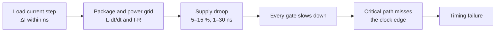

# 1. Background: supply droops and why we monitor them

[← Documentation index](README.md) · Next: [2. Architecture and theory of operation →](02-architecture.md)

## 1.1 What a supply droop is

A digital chip draws current from its supply through the package and the on-die power grid. Both have resistance *R* and inductance *L*. When a large block suddenly starts switching (a core wakes up, a vector unit starts), the current steps up by Δ*I* within nanoseconds, and the local supply sags:

```
V_DD,local(t) ≈ V_DD,nominal − I·R − L·dI/dt
```

The *L·dI/dt* term dominates for fast steps. The result is a **droop**: a dip of a few percent to ~15 % of the supply that lasts from about a nanosecond to tens of nanoseconds, before the decoupling capacitance and the voltage regulator recover it.



## 1.2 Why a droop matters

Gate delay depends strongly on the supply. In the alpha-power model

```
t_gate ∝ C_L · V_DD / (V_DD − V_t)^α ,    1 < α ≤ 2
```

so a lower supply makes every gate slower. In this design, each 1 % of supply drop costs about 3 % of delay for small droops, and at a 15 % droop the TDC stages and the replica path are about 1.7× slower than at 1.0 V (see [the edge-race figure](06-results.md#inside-the-tdc-the-edge-race)).

A chip that must never fail therefore runs with a **guard band**: its clock is set slow enough to survive the worst droop, even though that droop is rare. That costs performance and energy all the time.

## 1.3 What an on-die droop monitor buys

If the chip can **see** a droop within a few nanoseconds, it can react only when needed:

- stretch or gate the clock for a few cycles (adaptive clocking),
- throttle the instruction issue rate,
- or log the event for silicon debug.

The clock can then run closer to the typical-case limit. This needs a monitor that is

| Requirement | Why |
|---|---|
| **fast** (a few ns, a few cycles) | the droop's first, deepest dip is the dangerous part |
| **on the same supply** it protects | it must feel exactly what the logic feels |
| **small and low power** | many copies sit across the die |
| **digital** (no analog reference) | easy to place in a logic flow, no quiet supply or bias needed |
| **robust over process and temperature** | a false alarm costs performance; a miss costs correctness |

## 1.4 Families of droop monitors

| Family | Principle | Strengths | Weaknesses | Examples |
|---|---|---|---|---|
| Analog sensing | compare the supply against a reference (comparator, CCO, capacitor ratio) | accurate in volts | needs a quiet reference supply, bias or matched capacitors; analog design effort | Muhtaroglu JSSC'04, Mizrahi Access'21, Shifman JSSC'22 |
| **Delay-based digital** | measure how far an edge travels through logic in a fixed time | measures what matters to logic (delay); synthesizable gates; tracks FMAX | delay-to-voltage map depends on process and temperature, so it needs calibration | **Bowman CICC'10 / TCAS-I'11 (this design)**, Tschanz TRC |
| High-rate digital sensors | ring oscillators / multi-phase TDCs at GS/s | mV resolution, very fast | larger, more power, more complex calibration | Whatmough JSSC'17, Du TCAS-I'23, Qian ISCAS'25 |

The full comparison, with numbers, is in [6. Results → comparison](06-results.md#comparison-with-published-supply-droop-monitors).

## 1.5 The reference design: Bowman's dynamic variation monitor (DVM)

Bowman *et al.* (Intel, 45 nm) proposed an **all-digital dynamic variation monitor**:

1. A **tunable replica circuit (TRC)** mimics the chip's critical path. Its delay changes with the supply exactly like real logic does.
2. A **time-to-digital converter (TDC)**, a chain of inverters with a latch on every stage, measures how far the TRC's output edge travels within one clock period.
3. The resulting **thermometer code** is high when the supply is high (fast logic) and drops during a droop (slow logic).
4. Simple **decision logic** compares selected TDC taps with thresholds and raises flags.

In their 45-nm silicon the TDC stage was 6.5 ps and the replica could be tuned in 10-ps steps (under 1 % of FMAX).

## 1.6 What this project does

We built that DVM ourselves, **at transistor level, in a generic 45-nm process (gpdk045)**, and took it through **layout, DRC/LVS and parasitic extraction**. We then:

- found and fixed why the design failed after extraction (the TDC stage became 1.75× slower),
- characterized it over **15 process–temperature corners** and **Monte Carlo**,
- found that with fixed thresholds it **false-alarms at 6 of 15 corners**, and
- added **TAP_CAL**, a small calibration block with per-die thresholds and end-of-hold sampling, which removes every no-droop false alarm.

### Objectives (from the report)

| | Objective | Outcome |
|---|---|---|
| O1 | Flag 5 / 10 / 15 % droops of a 1.0-V supply | ✅ at TT; partly across corners (ff −40 °C misses 5 % and 10 %, hot corners over-grade 10 %) |
| O2 | No false warning without a droop, at all PVT corners | ✅ with TAP_CAL (0/15); the fixed-threshold DVM fails 6/15 |
| O3 | Detection latency ≤ 2 samples (5 ns) | ✅ 1.9–4.5 ns at TT, 4.94 ns at the worst corner |
| O4 | Area ≤ 0.005 mm², power ≤ 300 µW | ✅ 659 µm², 138 µW |
| O5 | DRC/LVS-clean layout with extracted verification | ✅ |
| O6 | PVT and Monte Carlo characterization | ✅ 15 corners, 100-sample MC |

Scope: simulation only (no silicon), droops up to 15 %. The calibration settings *T* and *S* are assumed to be chosen once per die at test, from the no-droop code.

---

[← Documentation index](README.md) · Next: [2. Architecture and theory of operation →](02-architecture.md)
