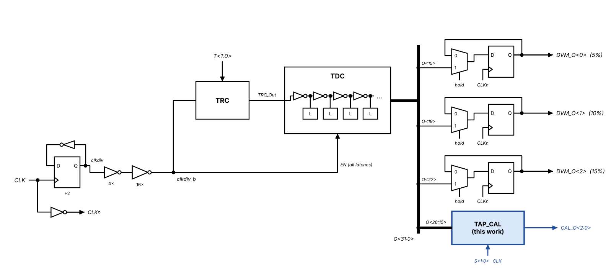
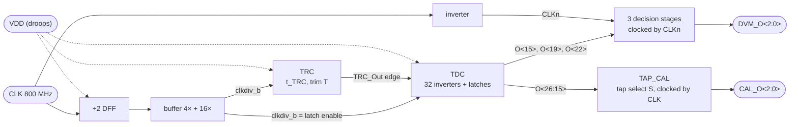
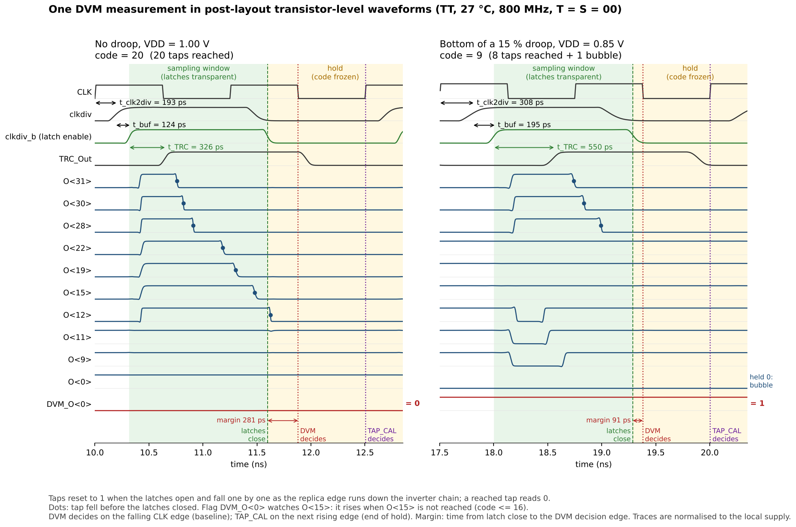
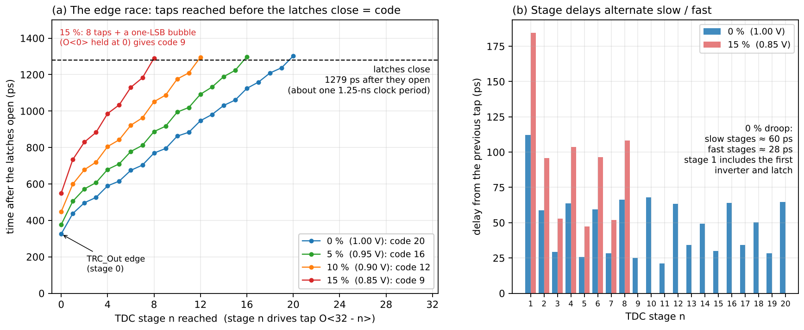
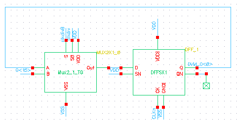
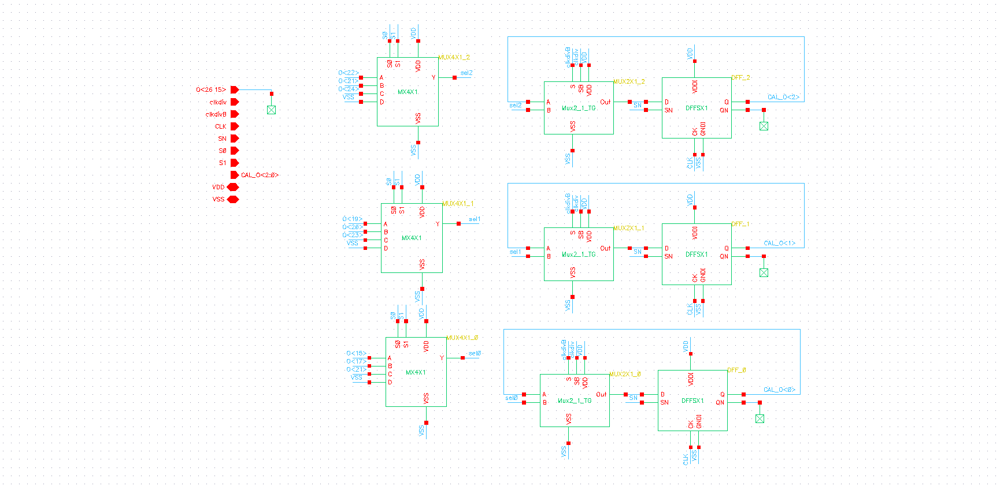

# 2. Architecture and theory of operation

[← 1. Background](01-background.md) · [Documentation index](README.md) · Next: [3. Circuits and cells →](03-circuits-and-cells.md)

This chapter explains how the monitor turns a supply voltage into a 3-level warning, using numbers measured on the post-layout (parasitic-extracted) design at TT, 27 °C, 1.0 V, 800 MHz unless stated.

- [2.1 Block diagram](#21-block-diagram)
- [2.2 Clocking: one measurement every two cycles](#22-clocking-one-measurement-every-two-cycles)
- [2.3 Tunable replica circuit (TRC)](#23-tunable-replica-circuit-trc)
- [2.4 Time-to-digital converter (TDC)](#24-time-to-digital-converter-tdc)
- [2.5 From taps to a code](#25-from-taps-to-a-code)
- [2.6 Design equations, with our numbers](#26-design-equations-with-our-numbers)
- [2.7 Decision stages and flags](#27-decision-stages-and-flags)
- [2.8 TAP_CAL: corner-calibrated thresholds (this work)](#28-tap_cal-corner-calibrated-thresholds-this-work)
- [2.9 Timing budget at a glance](#29-timing-budget-at-a-glance)

---

## 2.1 Block diagram

<p align="center"></p>

| Block | What it does | Built from |
|---|---|---|
| ÷2 divider | `CLK` (800 MHz) → `clkdiv` (400 MHz) | DFFSX1 with an inverter from Q back to D |
| Clock buffer | `clkdiv` → `clkdiv_b`, which opens and closes all 32 latches and launches the TRC | 4× inverter, then 16× inverter |
| `CLKn` inverter | `CLK` → `CLKn`, the clock of the baseline decision flip-flops | 1 inverter |
| TRC | replica of a logic path; delays the launch edge by `t_TRC` (trim `T<1:0>`) | 16 buffers in 4 groups + MX4X1 |
| TDC | 32 inverters; a latch on every stage holds where the edge got to | 32 × (inverter + D-latch) + 16 polarity inverters |
| Decision stages (×3) | turn taps `O<15>`, `O<19>`, `O<22>` into flags `DVM_O<0:2>` (5/10/15 %) | Mux2_1_TG + DFFSX1 each |
| **TAP_CAL** (novelty) | per-die choice of the three taps from `O<26:15>`, flags `CAL_O<0:2>` | 3 × (MX4X1 + Mux2_1_TG + DFFSX1) |

The full hierarchy, from leaf cells to the top, is in [`diagrams/`](../diagrams) and [Fig. 1 of the report](../report/P1G11_FinalReport.pdf).

### Signal flow



Everything, including the clock path, runs from the same supply `VDD_DVM` that droops. Only the clock period, set by the external clock, is fixed.

---

## 2.2 Clocking: one measurement every two cycles

The divider halves the clock, so `clkdiv_b` is high for one `CLK` period and low for the next:

| Phase | Duration | What happens |
|---|---|---|
| **Sampling window** (`clkdiv_b` high) | ≈ 1.25 ns (1.278 ns measured) | latches are transparent; taps are reset to 1, then the replica edge runs down the TDC and taps fall one by one |
| **Hold** (`clkdiv_b` low) | ≈ 1.25 ns | latches hold the thermometer code; the decision stages read it |

So the monitor delivers **one measurement per 2.5 ns (400 MS/s)** at an 800-MHz clock.

The rising edge of `clkdiv_b` does two jobs at once: it **opens the latches** and, delayed by the TRC, it **launches the edge** that the TDC measures. Its falling edge **closes the latches**. Because the start and the end of the window come from the same net, the clock-path delay (`t_clk2div + t_buf` = 193 + 124 = 317 ps) shifts the whole window but does not change its length. The window length is set by the clock period, which does not droop. That is what makes the measurement depend on the logic delay alone.

---

## 2.3 Tunable replica circuit (TRC)

The TRC is 16 buffers arranged as four groups of four, and a 4:1 multiplexer (MX4X1) that picks the output after 4, 8, 12 or 16 buffers with `T<1:0>`:

| `T` (= T1 T0) | buffers | `t_TRC` schematic (TT, 800 MHz) | `t_TRC` post-layout |
|---|---|---|---|
| 00 | 4 | 175.9 ps | **325.6 ps** (TT 27 °C) |
| 01 | 8 | 260.3 ps | – |
| 10 | 12 | 345.7 ps | 491.3 ps (ff 27 °C) |
| 11 | 16 | 425.0 ps | 462–591 ps (cold corners) |

*Schematic values: [`data/schematic/trc_trim_sweep.csv`](../data/schematic/trc_trim_sweep.csv). Post-layout values: [corner runs](../data/ade_xl/corners).*

The TRC has two roles:

1. It **mimics the logic being protected**. Its delay reacts to the supply like real logic, so the monitor measures "how slow is logic right now", which is what a clocking controller needs.
2. It **positions the window**. The TDC only sees the part of the window left after `t_TRC`. A larger `T` lowers the code, which is how fast corners (where everything is quicker and the code would saturate) are brought back into range.

`T` can only **add** delay. At slow and hot corners the code is already low, and no setting of `T` can raise it. That limitation is the reason for TAP_CAL ([§2.8](#28-tap_cal-corner-calibrated-thresholds-this-work)).

---

## 2.4 Time-to-digital converter (TDC)

The TDC is a chain of 32 inverters. Each stage output feeds a **transparent-high D-latch** whose enable is `clkdiv_b`; the latch outputs are the taps `O<31:0>`. `O<31>` belongs to the first stage, `O<0>` to the last. Because the edge alternates polarity at every inverter, a **polarity inverter after every second latch** makes all taps use the same convention:

> **A tap that the edge has reached reads 0. A tap it has not reached reads 1.**

Inside one window:

1. `clkdiv_b` rises: the latches become transparent and the taps go to 1 (the chain input is at its "not yet launched" level).
2. After `t_TRC` the replica edge enters the chain.
3. The edge travels one stage every ~47 ps (alternately ~60 ps and ~28 ps, see below). Each tap it passes falls to 0.
4. `clkdiv_b` falls: the latches close. The taps now hold a **thermometer code**: a run of zeros (reached) followed by ones (not reached).

<p align="center"></p>

*Real post-layout waveforms of one measurement ([`make_timing_diagram.py`](../scripts/make_timing_diagram.py)). Left: no droop, 20 taps reached. Right: at the bottom of a 15 % droop the clock path, the TRC and every stage are slower, so only 8 taps are reached before the latches close.*

### Why the stage delay alternates

The edge alternately **rises** and **falls** as it passes successive inverters, and an inverter's pull-up and pull-down delays differ (here W<sub>p</sub>/W<sub>n</sub> = 390/260 nm). Measured on the extracted TDC, consecutive taps are about **60 ps and 28 ps apart**. That is why even codes are wide (≈ 22.5 mV of supply) and odd codes narrow (2.5–5 mV), which is the DNL you see in the [static transfer curve](06-results.md#static-transfer-curve-resolution-dnl-inl). Balancing the inverter's rise and fall delays would even the steps.

<p align="center"></p>

*(a) When each tap is reached, for 0/5/10/15 % droop: the number of points below the latch-close line is the code. (b) The alternating 60/28-ps stage delays ([`make_tap_timing.py`](../scripts/make_tap_timing.py)).*

---

## 2.5 From taps to a code

The code is read directly from the transistor-level latch outputs during the hold phase, with no behavioural model:

```
code = 32 − Σ_{k=0}^{31} O_k(t_h) / V_DD          (report eq. 3)
```

Every reached tap (0 V) adds one to the code, every unreached tap (≈ V<sub>DD</sub>) adds nothing. At TT, 27 °C:

| Droop | V<sub>DD</sub> at the bottom | Taps reached | Code |
|---|---|---|---|
| 0 % | 1.00 V | `O<31:12>` (20 taps) | **20** |
| 5 % | 0.95 V | `O<31:16>` | **16** |
| 10 % | 0.90 V | `O<31:20>` | **12** |
| 15 % | 0.85 V | `O<31:24>` + one stale 0 | **9** |

**Bubble.** At 15 % the last tap `O<0>` reads 0 although the edge never got there. The chain is reset by the opposite edge of the replica, which is launched during the previous hold phase; at a deep droop the stages are so slow (~75 ps) that this reset edge has not reached the last stages by the time the latches close, so `O<0>` keeps its old value. It adds one LSB to the code. Such one-LSB bubbles are a known artefact of latch-based TDCs and the first sign that the TDC is near the end of its range. The flags only look at taps `O<15>`–`O<26>`, so they are not affected.

---

## 2.6 Design equations, with our numbers

With window `T_w` (≈ one clock period), replica delay `t_TRC` and average stage delay `t_s`:

```
code = floor( (T_w − t_TRC) / t_s )                      (report eq. 1)
```

At TT: (1278 ps − 326 ps) / 47.6 ps = **20.0**. The same equation predicts the no-droop code at all 15 corners within ±1 code ([corner timing figure](07-pvt-and-calibration.md#what-sets-the-code-at-each-corner)).

A droop that slows TRC and TDC by the fraction δ shifts the code by

```
Δcode ≈ −δ · T_w / t_s                                    (report eq. 2)
```

`T_w / t_s` ≈ 27 here, so a 15 % slow-down moves the code by about 4 codes. Measured: 5 % droop → +16 % `t_TRC` → code 16 (−4).

**Choosing the operating point.** Three things must fit inside the 32-stage TDC:

- the no-droop code needs headroom **above** it, because faster corners raise it (ff −40 °C reaches 28 even with maximum trim);
- a 15 % droop costs about 11 codes, so the no-droop code needs room **below** it;
- below code ≈ 9 the TDC runs out of range and aliases (the previous window's edge is still in the chain).

A no-droop code of **20** with taps at 16/12/9 for 5/10/15 % meets all three at TT. The 800-MHz clock (window 1.25 ns) was chosen to get there after extraction slowed the stage to 47 ps ([§9 design journey](09-design-journey.md)).

**Resolution.** Over the static sweep, codes 10–19 span 0.989 V to 0.856 V: **13.3 mV per code on average**. The **loading factor** κ = `t_s / τ_FO1` sets how fine the stage can be: κ = 47.1 / 10.78 = **4.4** post-layout (3.0 in the schematic, 1.4 in Bowman's silicon), because each chain inverter also drives a latch transmission gate and the wiring between stages.

---

## 2.7 Decision stages and flags

Each flag has one decision stage:

<p align="center"></p>
<p align="center"><sub>Decision stage for <code>DVM_O&lt;0&gt;</code> in Cadence: <code>MUX2X1_0</code> (Mux2_1_TG) and <code>DFF_1</code> (DFFSX1, clocked by <code>CLKn</code>, set input <code>SN</code> tied to V<sub>DD</sub>).</sub></p>

- A **transmission-gate 2:1 mux** (Mux2_1_TG, select `clkdivB`/`clkdiv`) passes its tap during the hold phase and otherwise feeds the flip-flop's own output back, so the flag does not see the moving taps during the window.
- A **D flip-flop** (DFFSX1) clocked by **`CLKn`**, i.e. on the falling edge of `CLK`, in the middle of the hold phase.

A flag is the **inverse of "tap reached"**: tap `O<k>` not reached ⇔ code ≤ 31 − k ⇔ flag = 1.

```
flag_k = 1  ⇔  code ≤ 31 − k                            (report eq. 4)
```

| Flag | Tap | Fires when | Meaning |
|---|---|---|---|
| `DVM_O<0>` | `O<15>` | code ≤ 16 | ≥ 5 % droop |
| `DVM_O<1>` | `O<19>` | code ≤ 12 | ≥ 10 % droop |
| `DVM_O<2>` | `O<22>` | code ≤ 9 | ≥ 15 % droop |

In a static sweep the flags switch at **0.9575, 0.905 and 0.8675 V** (4.25, 9.5, 13.25 % droop), each just before its nominal level, so a droop that reaches the level is always flagged.

**Timing margin.** The latches close 317 ps after `CLK` rises (clock path), and the decision flip-flop samples 625 ps after `CLK` rises (half a period). That leaves **281 ps** for the latch to settle and the mux to pass the tap at TT, no droop. At the bottom of a 15 % droop the slower clock path leaves only **91 ps** (timing figure above), and at slow, hot corners (ss 125 °C, clock path > 500 ps) nothing. That race is why TAP_CAL samples later.

---

## 2.8 TAP_CAL: corner-calibrated thresholds (this work)

### The problem

Process and temperature move the **no-droop** code far more than a droop does:

| | Range of the no-droop code |
|---|---|
| Across the 15 corners (with the best `T`) | **9 to 28** |
| A 15 % droop at TT | 11 codes |

Fixed taps (16/12/9) therefore see a "droop" at every slow corner: at tt 125 °C the no-droop code is 12, so two flags fire with no droop at all. With fixed thresholds the DVM false-alarms at **6 of 15 corners**. The TRC trim cannot help there because it can only lower the code.

### The idea

Move the **thresholds** instead of the code. TAP_CAL is a separate block that reads `O<26:15>` from the TDC. For each flag, a 4:1 mux (MX4X1) selects one of four taps with `S<1:0>`, so the thresholds follow the die's own no-droop code:

| `S` | No-droop code | Tap for 5 % | 10 % | 15 % | Fires at code ≤ | Used at |
|---|---|---|---|---|---|---|
| 00 | ≈ 20 | `O<15>` | `O<19>` | `O<22>` | 16 / 12 / 9 | 27 °C and cold corners (with `T`) |
| 01 | ≈ 16 | `O<17>` | `O<20>` | `O<21>` | 14 / 11 / 10 | ff 125 °C |
| 10 | 12–14 | `O<21>` | `O<23>` | `O<24>` | 10 / 8 / 7 | tt / fs / sf 125 °C, ss 27 °C |
| 11 | 9 (aliased) | V<sub>SS</sub> | V<sub>SS</sub> | V<sub>SS</sub> | never | ss 125 °C (flags disabled) |

<p align="center"></p>

*TAP_CAL in Cadence: three MX4X1 tap selectors (left) and three decision stages clocked by `CLK` (right).*

`S` and `T` are set **once per die at test**: run the monitor with no droop, read the code, pick `T` to bring a fast die into range, then pick the `S` row whose no-droop code matches ([7. PVT and calibration](07-pvt-and-calibration.md#calibration-procedure)).

### End-of-hold sampling (retiming)

The TAP_CAL flip-flops are clocked by **`CLK`** instead of `CLKn`: they sample on the rising edge that **ends** the hold phase, 625 ps later than the baseline. This was found while testing `S = 11`: with the inputs tied low, flip-flops clocked like the baseline still output 111, i.e. they had never loaded at that corner. After retiming they output 000. Retiming

- removes the latch-close-to-sampling race at slow corners and under deep droops,
- costs about **0.5 ns of latency** (e.g. 4.31 → 4.79 ns at 10 %, TT, in the ADE XL runs; 4.87 ns in the final extracted test bench),
- and TAP_CAL adds about **11 µW** (6 %) of power.

### Result

Over the 60 corner–droop cases, correct detections rise from **41 to 50** and false warnings fall from **16 to 4**; **no corner raises a flag without a droop**. Details: [7. PVT and calibration](07-pvt-and-calibration.md).

---

## 2.9 Timing budget at a glance

Post-layout, TT, 27 °C, 1.0 V, 800 MHz, `T = S = 00`:

| Quantity | Value | Source |
|---|---|---|
| Clock period `t_clk` | 1.25 ns | test bench |
| Sampling window (`clkdiv_b` high) | 1.278 ns | waveforms |
| Measurement rate | 400 MS/s (one per 2.5 ns) | ÷2 clock |
| Divider clock-to-Q `t_clk2div` | 192.6 ps | ADE output |
| Clock buffer `t_buf` | 124.0 ps | ADE output |
| `clkdiv_b` rise time | 63.6 ps | ADE output |
| Replica delay `t_TRC` (T = 00) | 325.6 ps | ADE output |
| Average TDC stage `t_s` | 47.1–47.6 ps (60 / 28 ps alternating) | ADE output, waveforms |
| No-droop code | 20 | eq. 3 |
| Latch close → baseline decision edge | 281 ps (91 ps at a 15 % droop) | waveforms |
| Detection latency, droop start → `DVM_O<0>` (5 / 10 / 15 %) | 4.10 / 4.31 / 1.95 ns | `state_tt` |

---

[← 1. Background](01-background.md) · [Documentation index](README.md) · Next: [3. Circuits and cells →](03-circuits-and-cells.md)
