# 3. Circuits and cells

[← 2. Architecture](02-architecture.md) · [Documentation index](README.md) · Next: [4. Layout and extraction →](04-layout-and-extraction.md)

Every cell is full custom in gpdk045 (45 nm, VDD = 1.0 V). This chapter goes bottom-up: leaf cells, building blocks, then the DVM, TAP_CAL and the top cell that holds the design and its test bench.

- [3.1 Device sizing](#31-device-sizing)
- [3.2 Leaf cells](#32-leaf-cells)
- [3.3 Building blocks](#33-building-blocks)
- [3.4 DVM top level](#34-dvm-top-level)
- [3.5 TAP_CAL](#35-tap_cal)
- [3.6 Design-under-test, test bench and top cell](#36-design-under-test-test-bench-and-top-cell)
- [3.7 Measured cell delays](#37-measured-cell-delays)

---

## 3.1 Device sizing

| Device group | L | Wn / Wp | Notes |
|---|---|---|---|
| Inverters, buffers, TDC chain, latches | 45 nm | 260 / 390 nm | Wp/Wn = 1.5 |
| Mux transmission gates (Mux2_1_TG) | 45 nm | 145 / 215 nm | smaller gates on the tap and select paths |
| Clock buffer | 45 nm | 4× and 16× the unit inverter | implemented as 4 and 16 parallel unit inverters (`IB1<3:0>`, `IB2<15:0>`) |

The unit inverter is not balanced for equal rise and fall delay. In the TDC this shows up as alternating ~60 ps / ~28 ps stage delays and hence the DNL pattern ([§2.4](02-architecture.md#why-the-stage-delay-alternates)).

---

## 3.2 Leaf cells

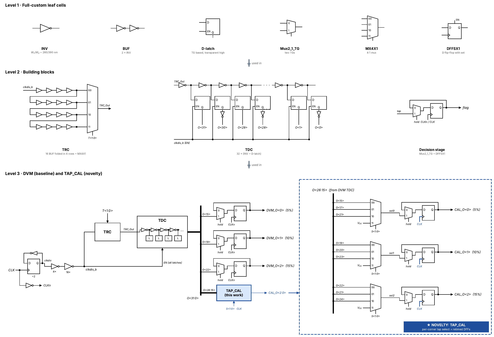

| Cell | Function | Where it is used | Layout |
|---|---|---|---|
| **INV** | inverter, Wn/Wp = 260/390 nm | TDC chain, polarity inverters, `CLKn`, divider feedback, clock buffer | 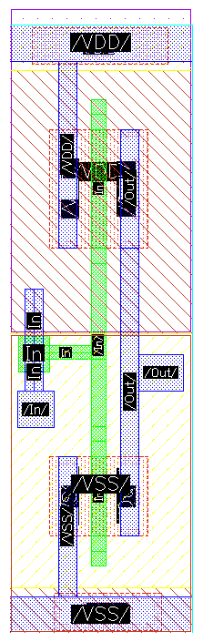 |
| **BUF** | two INVs in series | TRC (16×) | – |
| **D-latch** | transmission-gate latch, transparent while `EN` (= `clkdiv_b`) is high | one per TDC stage (32×) | 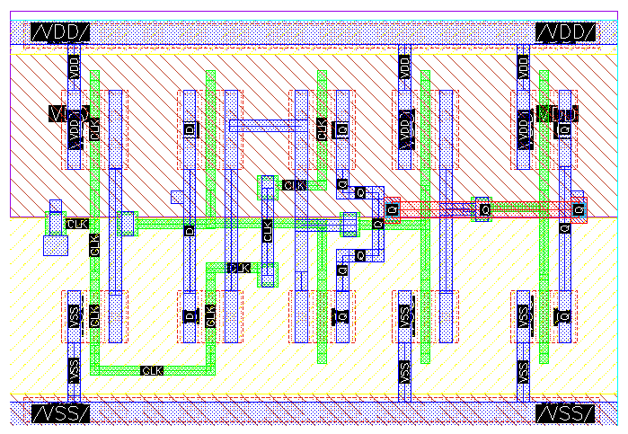 |
| **Mux2_1_TG** | 2:1 mux built from two transmission gates | decision stages (hold / recirculate) | 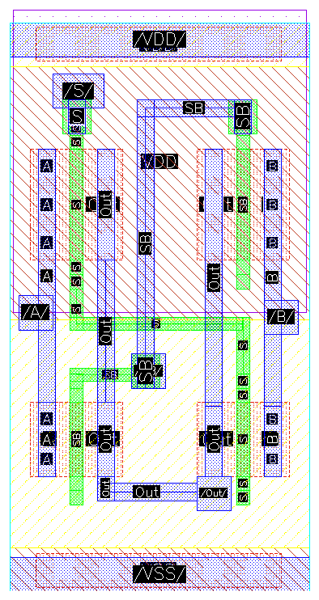 |
| **MX4X1** | 4:1 mux | TRC trim (`T<1:0>`), TAP_CAL tap select (`S<1:0>`) | 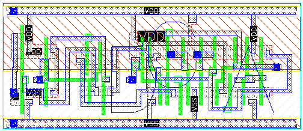 |
| **DFFSX1** | D flip-flop with active-low set `SN` | ÷2 divider, decision stages | 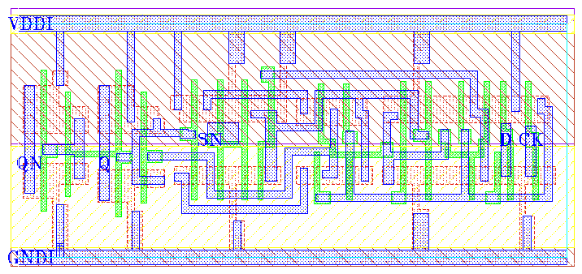 |

---

## 3.3 Building blocks

### Clock divider and buffer

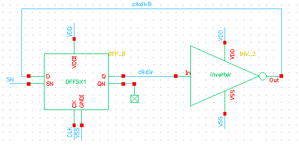&nbsp;&nbsp;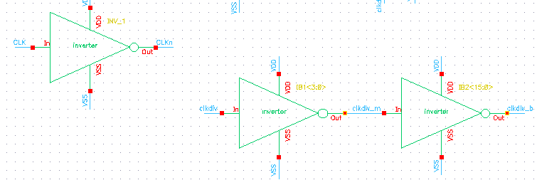

- **Divider** (`DFF_0` + `INV_2`): the flip-flop's Q (`clkdiv`) is inverted (`clkdivB`) and fed back to D, so `clkdiv` toggles on every rising `CLK` edge. `SN` (from the test bench) sets a known state at start-up.
- **Clock buffer**: a 4× inverter drives a 16× inverter (`clkdiv` → `clkdiv_m` → `clkdiv_b`). `clkdiv_b` drives the TRC input and all 32 latch enables. Without it, the divider flip-flop had to drive that whole net, and after extraction its edge became triangular ([§9](09-design-journey.md)). With it the edge rises in 63.6 ps.
- **`CLKn`** (`INV_1`): the inverted clock for the baseline decision flip-flops.

### Tunable replica circuit (TRC)

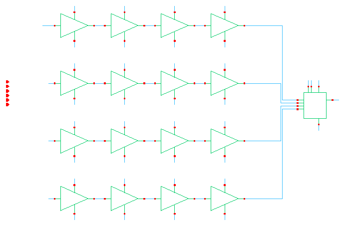&nbsp;&nbsp;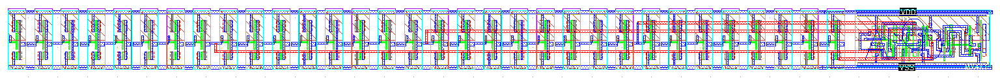

16 buffers in four groups of four, with an MX4X1 that picks the output after 4, 8, 12 or 16 buffers (`T<1:0>` = 00, 01, 10, 11). In the layout the chain is a single row with the mux at the end. Delays: [§2.3](02-architecture.md#23-tunable-replica-circuit-trc).

### Time-to-digital converter (TDC)

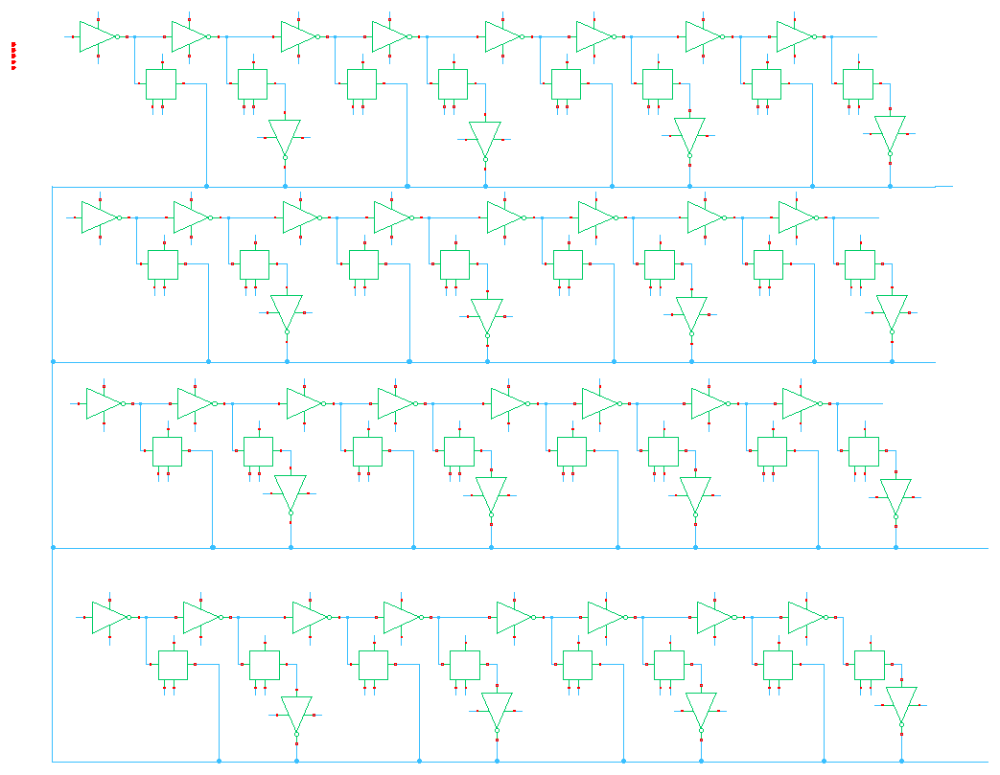

32 stages drawn as four rows of eight. Each stage is an inverter whose output drives the next inverter and a D-latch; a polarity inverter after every second latch makes every tap read 0 when reached. All latch enables are `clkdiv_b`.

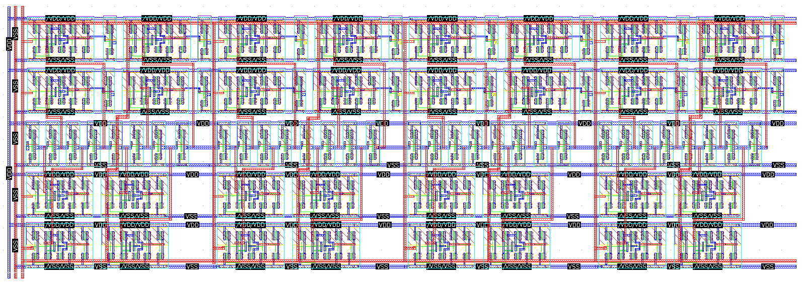

### Decision stage

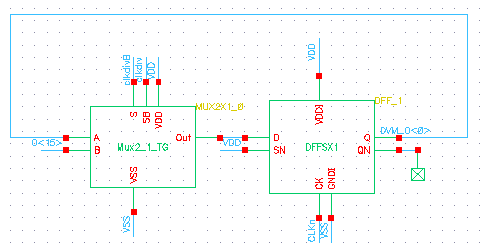

A Mux2_1_TG selects between the tap (during hold) and the flip-flop's own output (during the window), followed by a DFFSX1 clocked by `CLKn` with `SN` tied high. Three copies make `DVM_O<0:2>` from `O<15>`, `O<19>` and `O<22>`.

---

## 3.4 DVM top level

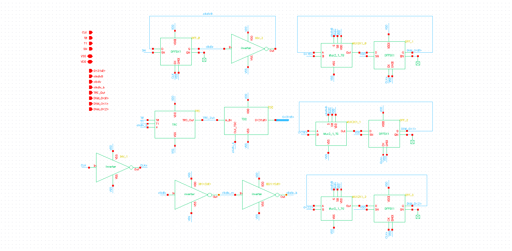

| Instance | Cell | Role |
|---|---|---|
| `DFF_0`, `INV_2` | DFFSX1, inverter | ÷2 divider (`clkdiv`, `clkdivB`) |
| `INV_1` | inverter | `CLK` → `CLKn` |
| `IB1<3:0>`, `IB2<15:0>` | inverter arrays | 4× / 16× clock buffer → `clkdiv_b` |
| `TRC` | TRC | replica delay, trim `T0`, `T1` |
| `TDC` | TDC | 32 taps `O<31:0>` |
| `MUX2X1_0..2`, `DFF_1..3` | Mux2_1_TG, DFFSX1 | decision stages → `DVM_O<0:2>` |

**Pins.** Inputs `CLK`, `SN`, `T0`, `T1`; supplies `VDD`, `VSS`; outputs `O<31:0>`, `DVM_O<2:0>`, `clkdiv`, `clkdivB`, `clkdiv_b`, `TRC_Out` (the internal clocks and the replica output are brought out so they can be measured).

---

## 3.5 TAP_CAL

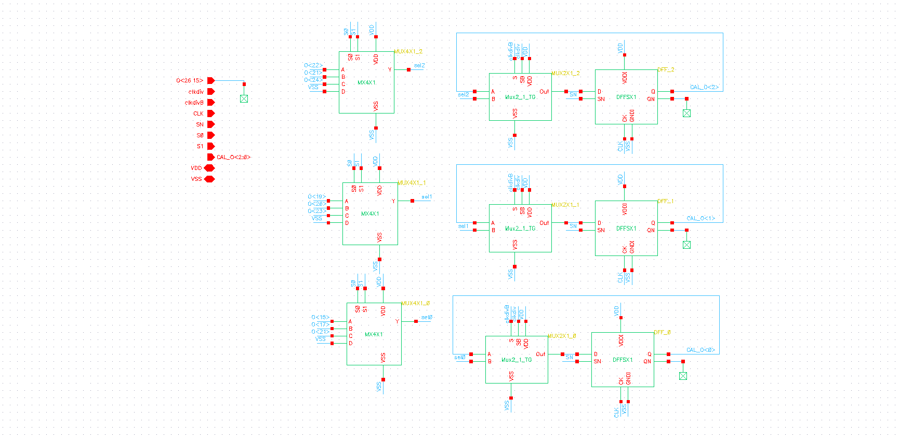

| Instance | Cell | Inputs A / B / C / D (S = 00 / 01 / 10 / 11) | Output |
|---|---|---|---|
| `MUX4X1_0` | MX4X1 | `O<15>` / `O<17>` / `O<21>` / VSS | `sel0` |
| `MUX4X1_1` | MX4X1 | `O<19>` / `O<20>` / `O<23>` / VSS | `sel1` |
| `MUX4X1_2` | MX4X1 | `O<22>` / `O<21>` / `O<24>` / VSS | `sel2` |
| `MUX2X1_0..2`, `DFF_0..2` | Mux2_1_TG, DFFSX1 | `sel0..2`, hold/recirculate, **clocked by `CLK`** (end of hold) | `CAL_O<0:2>` |

**Pins.** Inputs `O<26:15>`, `clkdiv`, `clkdivB`, `CLK`, `SN`, `S0`, `S1`; supplies `VDD`, `VSS`; outputs `CAL_O<2:0>`.

TAP_CAL is a **separate block** next to the DVM: the DVM, its layout and its flags are unchanged, so the baseline and the improved flags can be compared in the same simulation.

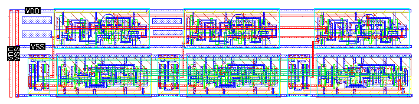

---

## 3.6 Design-under-test, test bench and top cell

The final verification cell has exactly two instances, so that one saved simulation state reproduces every number:

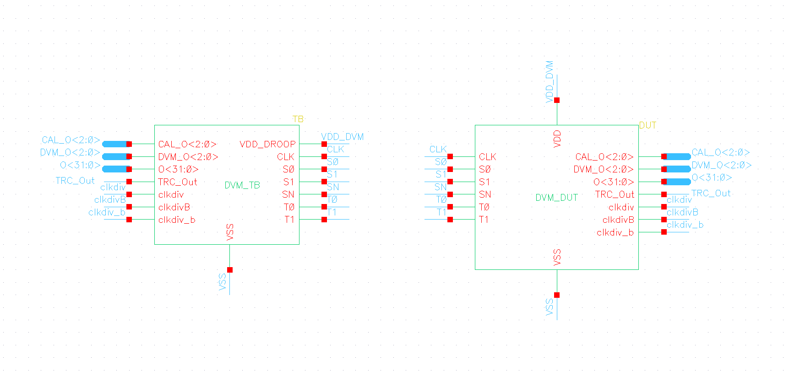

| Cell | Contents | Pins |
|---|---|---|
| **`DVM_DUT`** | `DVM_I0` (the DVM) + TAP_CAL, sharing one supply | in: `CLK SN T0 T1 S0 S1`; inout: `VDD VSS`; out: `O<31:0> DVM_O<2:0> CAL_O<2:0> clkdiv clkdivB clkdiv_b TRC_Out` |
| **`DVM_TB`** | Verilog-A droop source `VDD_droop3`, 0-V supply probe, clock, `SN`, `T0/T1/S0/S1` sources; no-connects on the observed outputs | out: `VDD_DROOP CLK SN T0 T1 S0 S1`; inout: `VSS`; in: the observed outputs |
| **`DVM_TOP`** | `TB` (DVM_TB) + `DUT` (DVM_DUT); a `config` view binds DVM and TAP_CAL to their extracted views | – |

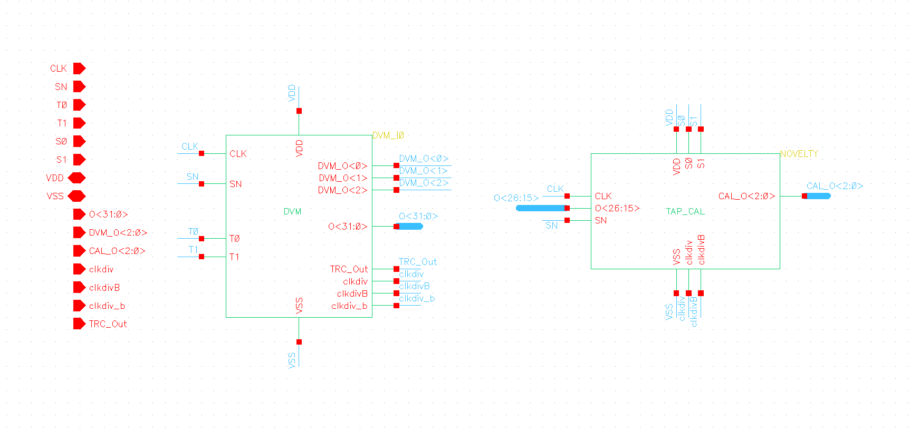&nbsp;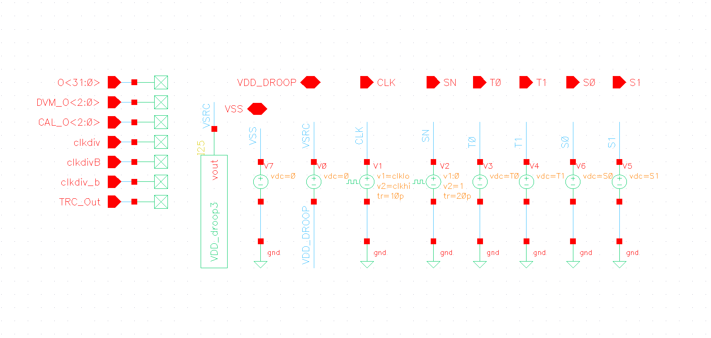

Test-bench values, design variables and the measurement expressions are in [5. Simulation setup](05-simulation-setup.md).

---

## 3.7 Measured cell delays

VDD = 1.0 V, TT, 27 °C (report Table II):

| Metric | Bowman TCAS-I'11 | Schematic | Extracted |
|---|---|---|---|
| τFO1 (inverter driving one inverter) | ≈ 4.6 ps (derived) | 8.33 ps | 10.78 ps |
| Buffer (FO1) | – | 18.34 ps | 25.2 ps |
| ÷2 DFF clock-to-Q | – | 49.28 ps | 192.6 ps (loaded) |
| TDC stage `t_s` | 6.5 ps | 25.0 ps stand-alone / 26.9 ps in the DVM | 47.1 ps |
| κ = `t_s` / τFO1 | 1.4 | 3.0 | 4.4 |

A stand-alone schematic TDC reaches 7 / 11 / 15 stages in 200 / 300 / 400-ps windows (25.0 ps per stage). Our κ is higher than Bowman's because each chain inverter also drives a latch transmission gate, and after extraction the wiring between stages adds more ([4. Layout and extraction](04-layout-and-extraction.md#what-extraction-changed)).

---

[← 2. Architecture](02-architecture.md) · [Documentation index](README.md) · Next: [4. Layout and extraction →](04-layout-and-extraction.md)
