# 4. Layout and extraction

[← 3. Circuits and cells](03-circuits-and-cells.md) · [Documentation index](README.md) · Next: [5. Simulation setup →](05-simulation-setup.md)

- [4.1 DVM floorplan](#41-dvm-floorplan)
- [4.2 Blocks and cells](#42-blocks-and-cells)
- [4.3 Physical verification flow](#43-physical-verification-flow)
- [4.4 What extraction changed](#what-extraction-changed)
- [4.5 Layout practices and their limits](#45-layout-practices-and-their-limits)

---

## 4.1 DVM floorplan

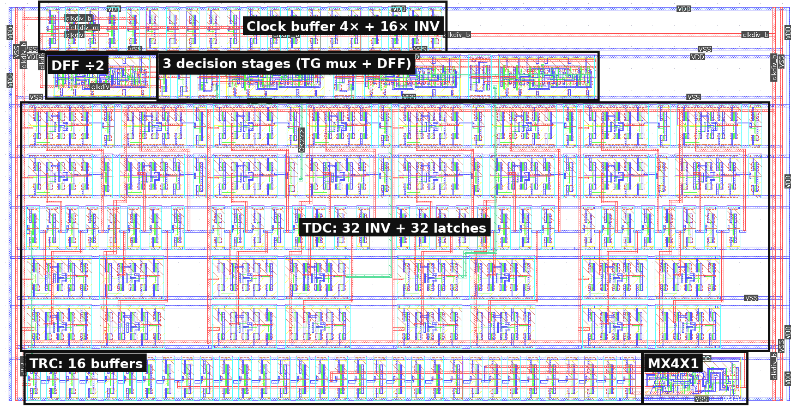

**36.17 µm × 18.21 µm = 658.7 µm²** (0.00066 mm², 13 % of the 0.005 mm² budget). DRC clean, LVS matched, parasitic (RC) extracted.

| Region | Contents |
|---|---|
| Top (two rows) | 4× + 16× clock-buffer inverters; below them the ÷2 DFF and the three decision stages (TG mux + DFF) |
| Middle (five cell rows) | TDC: 32 inverters + 32 latches + polarity inverters |
| Bottom row | TRC: 16 buffers in a single row, with the MX4X1 trim mux at the right end |

Common style for all cells: 2-µm cell rows, **Metal1** power rails (VDD top, VSS bottom), **Metal2** for buses and inter-cell routing. The clock net `clkdiv_b` runs from the buffer to every latch enable and to the TRC input.

Unannotated layout

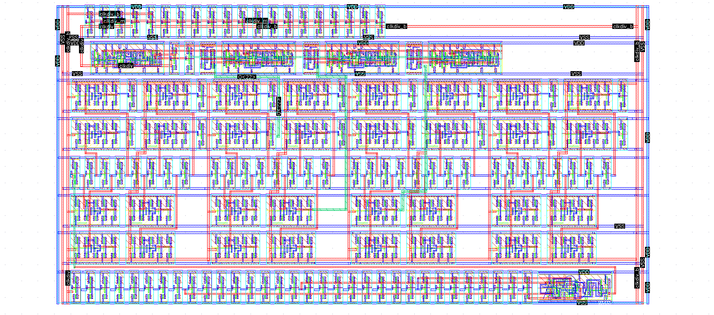

---

## 4.2 Blocks and cells

<table>
<tr>
<td width="55%">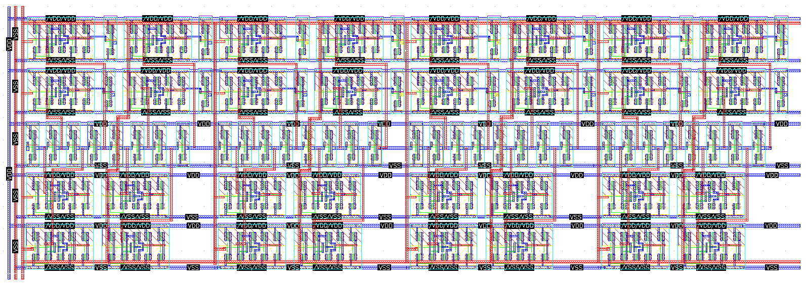 <b>TDC</b>: 32 inverters and 32 latches, folded into five cell rows.</td>
<td width="45%">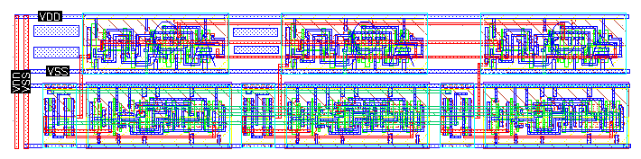 <b>TAP_CAL</b>: three MX4X1 + three decision stages. LVS matched and extracted.  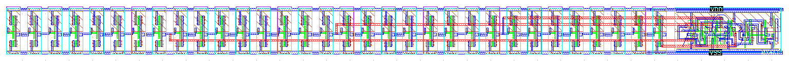 <b>TRC</b>: 16 buffers + MX4X1.</td>
</tr>
</table>

| D-latch | TG mux (Mux2_1_TG) | Inverter | DFF (DFFSX1) | 4:1 mux (MX4X1) |
|---|---|---|---|---|
| 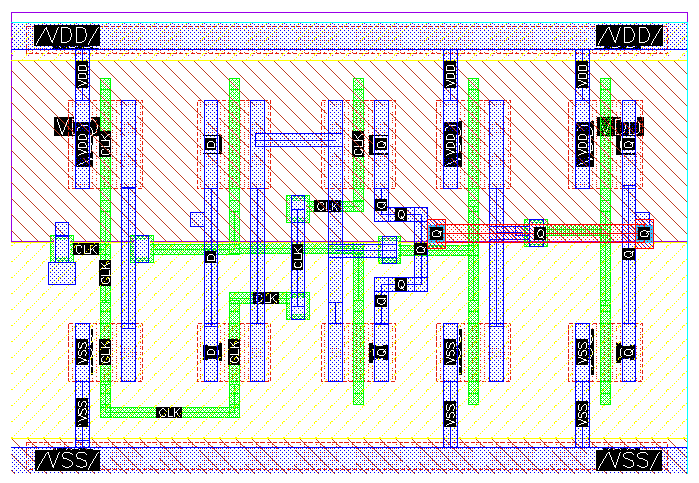 | 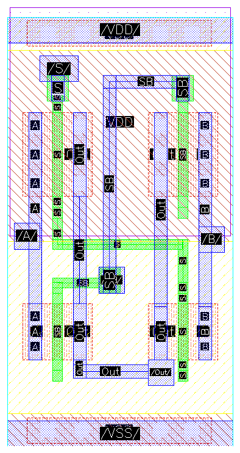 | 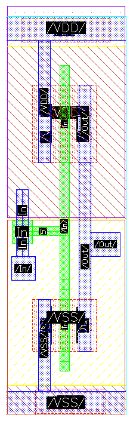 | 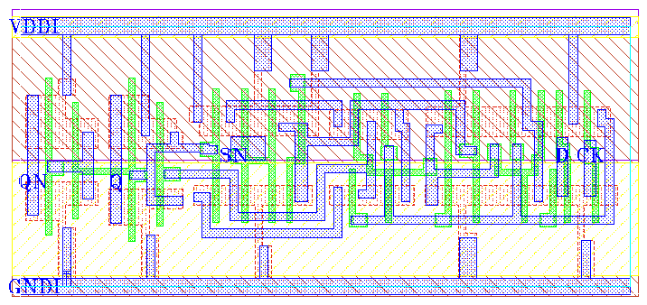 | 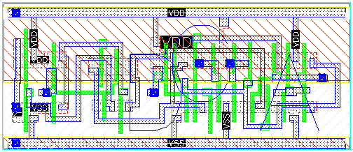 |

*Cells not to the same scale.*

---

## 4.3 Physical verification flow

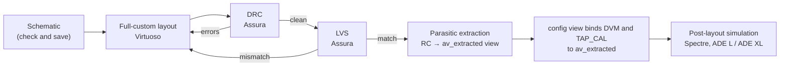

Typical LVS problems met on the way (and fixed): open labels (a pin label not touching its metal), pins shorted by an extra overlap, and a pin-swap artefact in the LVS report.

Every post-layout number in this repository comes from simulations of the **`av_extracted`** views, selected through a `config` view (or the switch view list `spectre av_extracted cmos_sch cmos.sch schematic veriloga`).

---

## 4.4 What extraction changed

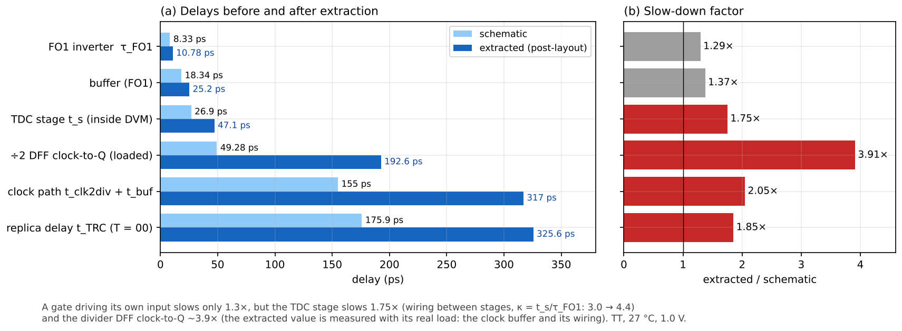

| | Schematic | Extracted | Ratio |
|---|---|---|---|
| τFO1 | 8.33 ps | 10.78 ps | 1.29× |
| TDC stage `t_s` | 26.9 ps | 47.1 ps | **1.75×** |
| κ = `t_s` / τFO1 | 3.0 | 4.4 | |
| Clock path `t_clk2div + t_buf` (800 MHz) | 155 ps | 317 ps | 2.05× |
| `t_TRC` (T = 00, 800 MHz) | 175.9 ps | 325.6 ps | 1.85× |
| No-droop code at 800 MHz | 32 (saturated) | 20 | |

A gate driving only its own fan-out slows by ~1.3×, but the TDC stage slows by 1.75×: most of the loss is the **wiring between TDC stages**, which every stage has to charge on top of the next inverter and the latch input. The divider flip-flop, which drives the clock buffer and its wiring, slows even more.

Consequences, and how they were handled ([§9 design journey](09-design-journey.md)):

| Problem after extraction | Fix |
|---|---|
| The divider DFF could not drive the 32 latch enables: triangular latch clock, false flags | 4× + 16× clock buffer (edge now 63.6 ps) |
| Slower stage: at 1 GHz the window was too short for a usable code range | clock lowered to **800 MHz** (1.25-ns window, code 20) |
| Codes moved | taps re-selected to `O<15>`, `O<19>`, `O<22>` (thresholds 16 / 12 / 9) |
| Energy per cycle | 144 fJ (schematic, 1 GHz) → 173 fJ (post-layout, 800 MHz) |

The full before/after table is Table III of the report and [Fig. 3a](06-results.md#recovering-the-post-layout-design).

---

## 4.5 Layout practices and their limits

| Practice | Status | Comment |
|---|---|---|
| DRC / LVS clean, PEX | ✅ DVM and TAP_CAL | |
| Regular rows, shared rails | ✅ | 2-µm rows, Metal1 rails, Metal2 buses |
| Compact floorplan | ✅ | 659 µm², smallest of the compared monitors |
| Clock routing | ✅ after the fix | one buffered `clkdiv_b` net to all latches and the TRC |
| Guard rings, common-centroid, dummies | ✗ not used | all-digital design; Monte Carlo shows **global** process variation dominates (94 % of the replica-delay variance), which matching techniques cannot remove; it is handled by per-die calibration (`T`, `S`) instead |
| Uniform TDC stages | partly | the stage delay alternates 60 / 28 ps (unequal rise and fall delays) with about ±10 ps of stage-to-stage variation on top ([tap timing](02-architecture.md#why-the-stage-delay-alternates)) |
| TAP_CAL area | not measured | only the DVM area enters the figures of merit |

---

[← 3. Circuits and cells](03-circuits-and-cells.md) · [Documentation index](README.md) · Next: [5. Simulation setup →](05-simulation-setup.md)
