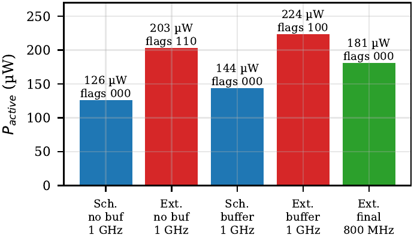
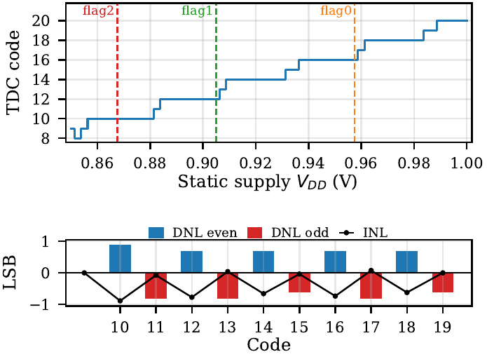
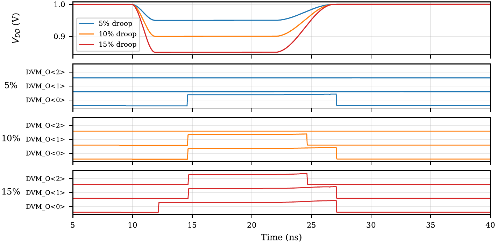
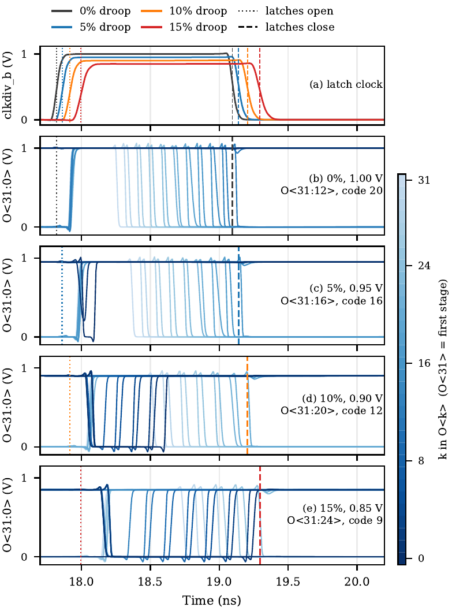
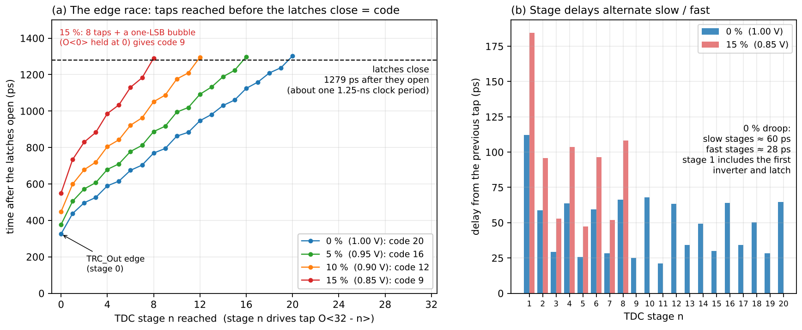
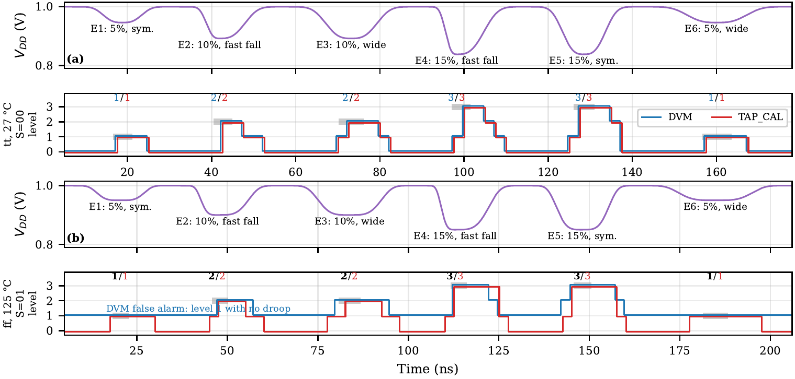
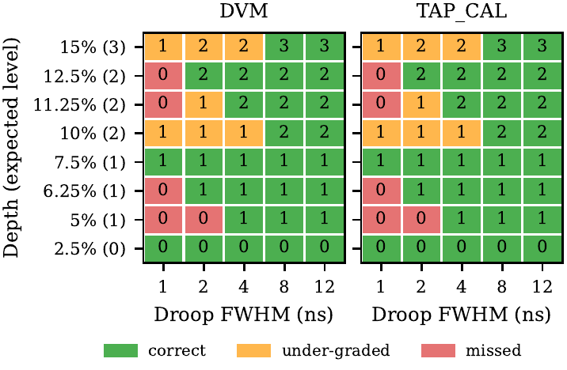

# 6. Results

[← 5. Simulation setup](05-simulation-setup.md) · [Documentation index](README.md) · Next: [7. PVT and calibration →](07-pvt-and-calibration.md)

All post-layout numbers: DVM (and TAP_CAL where stated) parasitic-extracted, gpdk045, 800 MHz, V<sub>DD</sub> = 1.0 V, TT, 27 °C, `T = S = 00`, unless stated. Each figure lists the script that draws it and the data it reads; all of them can be regenerated with [`scripts/reproduce_figures.sh`](../scripts/reproduce_figures.sh).

- [Headline numbers](#headline-numbers)
- [Recovering the post-layout design](#recovering-the-post-layout-design)
- [Static transfer curve: resolution, DNL, INL](#static-transfer-curve-resolution-dnl-inl)
- [Droop response and detection latency](#droop-response-and-detection-latency)
- [Inside the TDC: the edge race](#inside-the-tdc-the-edge-race)
- [Shortest flagged droop](#shortest-flagged-droop)
- [Droop trains](#droop-trains)
- [Detection map](#detection-map)
- [Power, energy and leakage](#power-energy-and-leakage)
- [Figure-of-merit summary](#figure-of-merit-summary)
- [PVT and Monte Carlo in brief](#pvt-and-monte-carlo-in-brief)
- [Comparison with published supply-droop monitors](#comparison-with-published-supply-droop-monitors)
- [Limitations](#limitations)

---

## Headline numbers

| | |
|---|---|
| Droop levels | 5 / 10 / 15 % of 1.0 V, as three flags |
| Detection latency | 1.9–4.5 ns (≤ 2 measurements) |
| Shortest flagged droop | 2 ns FWHM at 5 %, 1 ns at 10 % and 15 % (best sampling phase) |
| Resolution | 13.3 mV per code (average), DNL −0.81 / +0.89 LSB, INL −0.89 / +0.08 LSB |
| Active power / energy | 138.4 µW, 173 fJ per clock cycle (346 fJ per measurement) |
| Energy per detection | 0.28–0.71 pJ |
| Leakage | 5.67 nW (6.67 nW with TAP_CAL) |
| Area | 658.7 µm² |
| Corners | fixed thresholds: 41/60 correct, 16/60 false warnings; **TAP_CAL: 50/60 correct, 4/60 false warnings, 0 without droop** |
| Monte Carlo | 100/100 samples without a false flag, 4.3σ margin |

---

## Recovering the post-layout design

<p align="center"></p>

*TT, 27 °C, no droop. Active power (0-V probe: DVM + test-bench clock drivers) and the three flags through the design steps. Red: false flags. [`make_prepost.py`](../scripts/make_prepost.py), values logged from the ADE XL runs.*

| | 1 GHz, no clock buffer (direct implementation) | 800 MHz, buffered (final) |
|---|---|---|
| False flags with no droop | 2 of 3 | 0 of 3 |
| Latch-clock edge | triangular | 65-ps rise |
| Droop levels flagged | 0 of 3 | 3 of 3 |
| P<sub>act</sub> (probe) | 203 µW | 181 µW |

The schematic design point did not survive extraction: the TDC stage slowed 1.75× and the divider flip-flop could not drive the latch-enable net. A clock buffer, an 800-MHz clock and re-selected taps fixed it. The final DVM-only power, measured at its own supply terminal, is **138.4 µW**; the 181 µW above includes the test bench's clock drivers. Story and diagnosis: [9. Design journey](09-design-journey.md).

---

## Static transfer curve: resolution, DNL, INL

<p align="center"></p>

*Code at the bottom of a long, flat droop as the supply is stepped from 1.0 to 0.85 V in 2.5-mV steps (`state_static`). Dashed: supply at which each flag switches. [`make_dnl.py`](../scripts/make_dnl.py), data [`state_static.csv`](../data/ade_l_states/state_static.csv).*

Between 0.989 and 0.856 V the codes 19 → 10 give **13.25 mV per LSB** (endpoint fit). The code widths alternate:

| Code | 19 | 18 | 17 | 16 | 15 | 14 | 13 | 12 | 11 | 10 |
|---|---|---|---|---|---|---|---|---|---|---|
| Width (mV) | 5.0 | 22.5 | 2.5 | 22.5 | 5.0 | 22.5 | 2.5 | 22.5 | 2.5 | 25.0 |
| DNL (LSB) | −0.62 | +0.70 | −0.81 | +0.70 | −0.62 | +0.70 | −0.81 | +0.70 | −0.81 | +0.89 |
| INL (LSB) | 0.00 | −0.62 | +0.08 | −0.74 | −0.04 | −0.66 | +0.04 | −0.77 | −0.08 | −0.89 |

Even codes are wide and odd codes narrow because the TDC stages alternate between a slow (~60 ps) and a fast (~28 ps) transition ([§2.4](02-architecture.md#why-the-stage-delay-alternates)). With a 2.5-mV sweep step (0.19 LSB) the narrowest codes are resolved only to one step.

The flags switch at **0.9575 V, 0.905 V and 0.8675 V** (4.25 %, 9.5 %, 13.25 % droop), each just before its nominal level. Below 0.856 V the code aliases (the TDC is out of range).

---

## Droop response and detection latency

<p align="center"></p>

*Raised-cosine droops (2-ns fall, 10-ns bottom, 5-ns recovery, starting at 9.9 ns) and the transistor-level flags. [`make_wave.py`](../scripts/make_wave.py).*

| Droop | 5 % | 10 % | 15 % |
|---|---|---|---|
| Code (no droop → bottom) | 20 → 16 | 20 → 12 | 20 → 9 |
| `DVM_O<0:2>` | 100 | 110 | 111 |
| Latency flag0 / flag1 / flag2 | 4.10 / – / – ns | 4.31 / 4.31 / – ns | 1.95 / 4.45 / 4.45 ns |
| TAP_CAL latency (`CAL_O<0>`)\* | 4.67 ns | 4.87 ns | 2.48 ns |
| Flags cleared | 27.09 ns | 27.09 ns | 27.09 ns |
| Energy from droop start to flag0 | 627 fJ | 706 fJ | 280 fJ |

*Data: [`state_tt.csv`](../data/ade_l_states/state_tt.csv). \* Final test bench with the extracted TAP_CAL; the earlier ADE XL corner runs with the TAP_CAL schematic gave 4.79 ns at 10 % (the value in the report).*

**Reading the latency.** Latency runs from the moment the supply is 10 mV below nominal to the moment the flag crosses V<sub>DD</sub>/2. It is the sum of

1. the time the supply takes to reach the flag's level (the fall lasts 2 ns),
2. waiting for a measurement whose window sees the full depth (one measurement every 2.5 ns, window ≈ 1.25 ns), and
3. the decision delay (from latch close to the flag output, a few hundred ps).

A 15 % droop passes the 5 % level within about 0.8 ns of its start, so flag0 fires after 1.95 ns. A 5 % droop only reaches its level at the bottom, and because the threshold sits exactly on code 16 the next full measurement is needed: 4.10 ns. TAP_CAL samples at the end of the hold phase, half a cycle later (+0.5 ns).

The flags clear at 27.09 ns, at the first decision after the supply has recovered (recovery ends at 26.9 ns).

---

## Inside the TDC: the edge race

<p align="center"></p>

*All 32 taps in one sampling window at the droop bottom, for 0 / 5 / 10 / 15 % droop. (a) Latch clock `clkdiv_b`: it is also delayed by the droop. (b)–(e) Taps reset to 1 when the latches open and fall one by one; the deeper the droop, the fewer fall before the latches close. [`make_tdc_droop.py`](../scripts/make_tdc_droop.py), data `tt27_all.npz`.*

<p align="center"></p>

*The same data as arrival times: (a) the number of taps reached before the latches close is the code; (b) consecutive stages alternate between ~60 ps and ~28 ps. [`make_tap_timing.py`](../scripts/make_tap_timing.py).*

| Droop | `t_TRC` | Average stage (pair / 2) | Taps reached | Code |
|---|---|---|---|---|
| 0 % | 326 ps | 44 ps | 20 | 20 |
| 5 % | 377 ps | 51 ps | 16 | 16 |
| 10 % | 448 ps | 61 ps | 12 | 12 |
| 15 % | 550 ps | 75 ps | 8 (+1 bubble) | 9 |

The window stays 1.28 ns at every depth (it is set by the clock period), while the replica and every stage slow down together: that is the whole measurement principle.

---

## Shortest flagged droop

`state_short` applies V-shaped droops (`twidth = 0`, fall = rise = `w`, so FWHM = `w`) at two sampling phases (start at 9.9 ns and 11.15 ns, half a measurement apart). Flags `DVM_O<0:2>`; TAP_CAL gave identical flags in all 24 runs.

| Depth | Start | w = 1 ns | 1.5 ns | 2 ns | 3 ns |
|---|---|---|---|---|---|
| 5 % | 9.9 ns | 000 | 000 | 000 | 100 |
| 5 % | 11.15 ns | 000 | 000 | 100 | 000 |
| 10 % | 9.9 ns | 100 | 100 | 000 | 100 |
| 10 % | 11.15 ns | 000 | 100 | 100 | 100 |
| 15 % | 9.9 ns | 110 | 100 | 100 | 110 |
| 15 % | 11.15 ns | 000 | 110 | 110 | 110 |

A droop of a few ns is about as short as the 2.5-ns measurement interval, so whether it is caught depends on where it falls relative to the sampling window. Best case: **5 % from 2 ns, 10 % and 15 % from 1 ns FWHM**; at these widths 10 % and 15 % are graded one level low (100 and 110). Full grading needs about 8 ns ([detection map](#detection-map)). Data: [`state_short.csv`](../data/ade_l_states/state_short.csv).

---

## Droop trains

<p align="center"></p>

*Six droops of different depth and shape in one run. (a) TT, 27 °C, S = 00: droops overshoot their nominal depth by up to 8 % (less than one code); DVM and TAP_CAL grade all six correctly, flagged 0.5–2.7 ns after the supply reaches each level (TAP_CAL +0.5 ns). (b) ff, 125 °C, S = 01, exact depths: the DVM's 5 % flag never clears (false alarm), so 5 % droops are invisible to it; TAP_CAL has no false alarm and grades all six. Gray bars: expected level; labels: DVM / TAP_CAL level reached. [`make_train4.py`](../scripts/make_train4.py).*

---

## Detection map

<p align="center"></p>

*40 Gaussian droops (depth 2.5–15 %, FWHM 1–12 ns) in one transient at TT, 27 °C. [`make_matrix.py`](../scripts/make_matrix.py), data `matrix2_res.json`.*

- No false flags; 2.5 % is never flagged (correct: it is below the first level).
- From **8 ns** every droop is graded correctly by the DVM and TAP_CAL.
- From **4 ns** every droop ≥ 5 % is detected, but 10 % and 15 % read one level low: the thresholds sit on the nominal codes, so the full depth must last a whole measurement (≈ 1.3 ns window every 2.5 ns).
- At **1–2 ns** detection depends on the sampling phase.

Moving each tap one code earlier would add margin and let shorter droops reach their full grade, at the cost of switching earlier in a static sweep.

---

## Power, energy and leakage

| Condition | DVM | With TAP_CAL |
|---|---|---|
| Active, TT 27 °C, no droop | **138.4 µW** (173 fJ per cycle) | ≈ +11 µW (6 %) |
| Active, worst corner (ff −40 °C, T = 11) | 202.3 µW (253 fJ per cycle) | |
| Active, ff 125 °C / ss 27 °C | 187.3 / 182.9 µW | |
| Energy from droop start to flag0, 5 / 10 / 15 % | 627 / 706 / 280 fJ | |
| Leakage (clock stopped), TT 27 °C | **5.67 nW** | 6.67 nW |
| Leakage, ff 125 °C | 90.2 nW | 112 nW |

Leakage is about 0.004 % of the active power, so the power is almost entirely switching power: the divider and the clock buffer toggle every cycle, and the 32 latch enables, the replica and the TDC chain switch twice per measurement. Energy per detection is lowest for the deepest droop because flag0 fires earliest.

*Power is measured at the DVM's own supply terminal (`/DUT/DVM_I0/VDD`), averaged over 8 cycles; see [5.4](05-simulation-setup.md#54-measurement-expressions).*

---

## Figure-of-merit summary

Report Table VII. Every course figure of merit for the droop-detector project is listed.

| FoM | Condition | Spec | Pre-layout (1 GHz) | Post-layout (800 MHz) | Worst corner | Monte Carlo |
|---|---|---|---|---|---|---|
| Resolution | mV/LSB, static sweep | – | 10 mV | **13.3 mV** | 25 mV (125 °C) | n/m |
| DNL / INL (LSB) | codes 10–19 | – | n/m | −0.81..0.89 / −0.89..0.08 | n/m | n/m |
| Detection levels | flags | 5/10/15 % | 5/10/15 %† | **5/10/15 %** | 5 % only (hot) | – |
| Flag switching | static V<sub>DD</sub> | 0.95/0.90/0.85 V | n/m | 0.958/0.905/0.868 V | n/m | n/m |
| Shortest flagged droop | FWHM, 5 % / 10 % | – | n/m | 2 / 1 ns | n/m | n/a |
| Detection latency | droop → flag | ≤ 5 ns | 3.31 ns | **1.9–4.5 ns** | 4.94 ns (TAP_CAL, ss 27 °C, 10 %) | n/a |
| False warnings, no droop | 15 corners | 0 | n/m | DVM 6/15; **TAP_CAL 0/15** | ss 27: DVM 100 / CAL 000 | 0/100 |
| Active power | at f<sub>max</sub> | ≤ 300 µW | 143.9 µW | **138.4 µW** | 202.3 µW | 144.1 ± 2.2 µW‡ |
| TAP_CAL power overhead | TT, no droop | – | n/a | ≈ 11 µW (6 %) | n/m | n/a |
| Energy / cycle | P/f | – | 144 fJ | **173 fJ** | 253 fJ | 144 ± 2 fJ‡ |
| Energy / detection E<sub>tot</sub> | ∫P dt to flag | – | n/m | 0.28–0.71 pJ | 0.65 pJ | n/a |
| RWP | (mV/LSB) × T<sub>w</sub> | – | 10 mV·ns | 16.6 mV·ns | n/m | n/a |
| ERP | (P/f) × (mV/LSB) | – | 1.44 pJ·mV | 2.29 pJ·mV | n/m | n/a |
| FoM1 = RWP × ERP | lower is better | – | 1.44 × 10⁴ | 3.80 × 10⁴ | n/m | n/a |
| FoM2 = FoM1 × Area | lower is better | – | n/a | 2.50 × 10⁷ | n/a | n/a |
| Leakage | clock stopped | – | n/m | 5.67 (6.67) nW | 90.2 (112) nW | n/a |
| Area | layout (DVM) | ≤ 0.005 mm² | n/a | **658.7 µm²** | n/a | n/a |
| Calibration points | per die | – | – | 1 (sets S, T) | – | – |
| Reference; Verilog-A | – | – | – | clock only; none§ | – | – |

† Same taps in the schematic; not re-simulated with droops before layout. ‡ Schematic, 1 GHz, T = 11. § Only the test-bench droop source is Verilog-A. Worst-corner power and energy: ff −40 °C; leakage: ff 125 °C. Values in brackets include TAP_CAL. n/m: not measured; n/a: not applicable.

**How the combined figures of merit are computed** (course units: mV, ns, fJ, µm²; lower is better):

```
RWP  = resolution × T_w           = 13.25 mV × 1.25 ns      = 16.6 mV·ns
ERP  = (P/f) × resolution         = 173 fJ × 13.25 mV       = 2292 fJ·mV  (2.29 pJ·mV)
FoM1 = RWP × ERP                  = 16.6 × 2292             = 3.80 × 10⁴
FoM2 = FoM1 × area                = 3.80 × 10⁴ × 658.7 µm²  = 2.50 × 10⁷
```

---

## PVT and Monte Carlo in brief

| | Fixed thresholds (DVM) | TAP_CAL |
|---|---|---|
| Correct, 60 corner–droop cases | 41 | **50** |
| False warnings | 16 | **4** |
| Corners with a flag and no droop | 6 of 15 | **0 of 15** |

Monte Carlo (schematic, 100 samples, process + mismatch): code 20.9 ± 1.0, no false flag, 4.3σ margin; global process causes 94 % of the replica-delay variance. Full analysis: [7. PVT and calibration](07-pvt-and-calibration.md) and [8. Monte Carlo](08-monte-carlo.md).

---

## Comparison with published supply-droop monitors

Report Table VIII. "n/r": not reported. Data extracted from each paper.

| | [1] Muhtaroglu | [3, 5] Bowman | [2] Whatmough | [8] Mizrahi | [7] Shifman | [9] Du | [10] Qian | **This work** |
|---|---|---|---|---|---|---|---|---|
| Published | JSSC'04 | CICC'10 / TCAS-I'11 | JSSC'17 | Access'21 | JSSC'22 | TCAS-I'23 | ISCAS'25 | course project |
| Technology | 90 nm | 45 nm | 28 nm | 65 nm | 65 nm | 28 nm | 22 nm | **45 nm** |
| Principle | analog sensing | TRC + TDC | digital delay sensor | CCO + counter | inverter / cap. ratio | ring osc. + Nyquist counter | multi-phase ring-osc. TDC | **TRC + latch TDC** |
| All-digital | no | yes | yes | no | no | yes | yes | **yes** |
| Sampling rate | core clock | 1 per 2 clk | 0.4–2.24 GS/s | 1.6-µs count | 500 MHz | 0.5–2 GS/s | 2 GS/s | **400 MS/s** |
| Resolution | 20 mV step (7 mV hi-res) | 6.5-ps TDC step | 3.3 mV @ 0.8 GS/s | 10 mV | 0.9 % V<sub>DD</sub> | 1.92–7.32 mV/LSB | 7.01 mV/LSB | **13.3 mV/LSB** |
| DNL / INL | n/r | n/r | 0.6 / 0.9 LSB | n/r | n/r | n/r | n/r | **0.89 / 0.89 LSB** |
| Detection levels | 1 threshold | 3 flags | multi-bit code | multi-bit code | 3 levels | multi-bit code | multi-bit code | **3 levels** |
| Detection latency | n/r | 2-cycle readout | 2 cycles | ≈ 5 ns | 2–3.5 ns | 0 (prediction) | n/r | **1.9–4.5 ns** |
| Min. droop duration | 100 ps (sim.) | n/r | n/r | n/r | ≈ 2 ns | n/r | n/r | **1 ns FWHM** |
| False warnings over corners | n/r | n/r | n/r | n/r | n/r | n/r | n/r | **0/15** |
| Area (µm²) | n/r | 1990 | 108500 (macro) | 8800 | 8500 | 1427 (sensor) | 819 | **659** |
| Power | n/r | n/r | 416 µW (macro) | 297 µW | 62 µW (1.2 V) | 4.93 mW | 2.19 mW | **138 µW** |
| Energy / cycle | n/r | n/r | 520 fJ\* | n/r | 124 fJ\* | 2.46 pJ\* | 1.10 pJ\* | **173 fJ** |
| E<sub>tot</sub> per detection, RWP, ERP, FoM1, FoM2, leakage | n/r | n/r | n/r | n/r | n/r | n/r | n/r | **0.28–0.71 pJ, 16.6, 2.29, 3.80e4, 2.50e7, 5.7 nW** |
| Calibration | 5-bit DAC per module | V/f sweep | V sweep (LUT) | 2 temperatures | 1 temperature | V sweep, 16 temps | n/r | **1 point** |
| Reference required | quiet supply + current ref. | clock | clock | analog bias, quiet supply | quiet analog supply | clock + temp. sensor | clock (multi-phase) | **clock only** |
| PVT handling | DAC calibration | TRC calibration | software F-to-V | DC-level independent | capacitor ratio | dynamic PVT cal. | n/r | **T trim + TAP_CAL** |
| Result type | measured | measured | measured | measured | measured | measured | simulated (HSPICE) | **post-layout sim.** |

\* Derived here as power / clock (sampling) frequency.

**Where this design stands.** It has the **smallest area** of the compared monitors and the **second-lowest power and energy per cycle** (after Shifman's analog detector), needs **only a clock**, and is the only one that reports **false warnings across corners**. Its resolution is **2–7× coarser** than the 22–28-nm GS/s sensors, which use faster processes and many more stages, and its range is limited by the 32-stage TDC. It is post-layout simulation, while most of the others are silicon.

---

## Limitations

| Limitation | Cause | Possible fix |
|---|---|---|
| At hot corners TAP_CAL grades only one level reliably (≥ 5 %); ss 125 °C is disabled | the no-droop code is already 9–14 and the TDC aliases below ≈ 9 | a longer or faster TDC, or a higher `T` range in the other direction (a faster TRC) |
| ff −40 °C misses 5 % and 10 % | code 28 even with the maximum trim | a longer TRC trim range, or a TAP_CAL table for high codes |
| Droops shorter than ≈ 8 ns are graded one level low | thresholds sit exactly on the nominal codes | move each tap one code earlier |
| DNL up to −0.81 LSB | unequal rise and fall delays in the TDC stage (60 / 28 ps) | size the inverter for equal t<sub>pLH</sub> and t<sub>pHL</sub> |
| 800 MHz instead of 1 GHz, 173 instead of 144 fJ per cycle | 1.75× slower extracted stage | a lighter latch load or a two-level (coarse/fine) TDC |
| Monte Carlo on the schematic only | flow choice | repeat on the extracted views |
| Simulation only | course scope | silicon |

---

[← 5. Simulation setup](05-simulation-setup.md) · [Documentation index](README.md) · Next: [7. PVT and calibration →](07-pvt-and-calibration.md)
