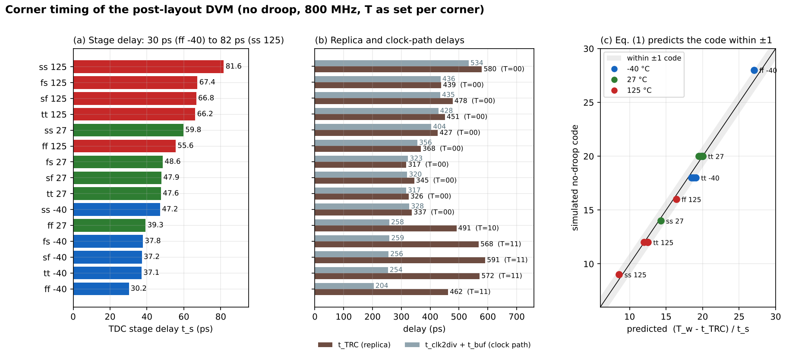
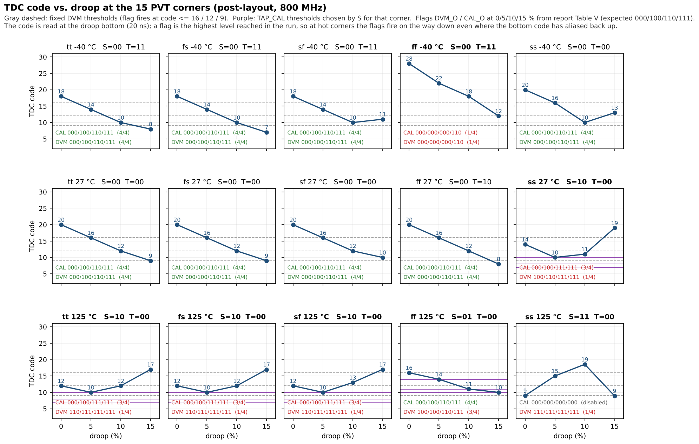
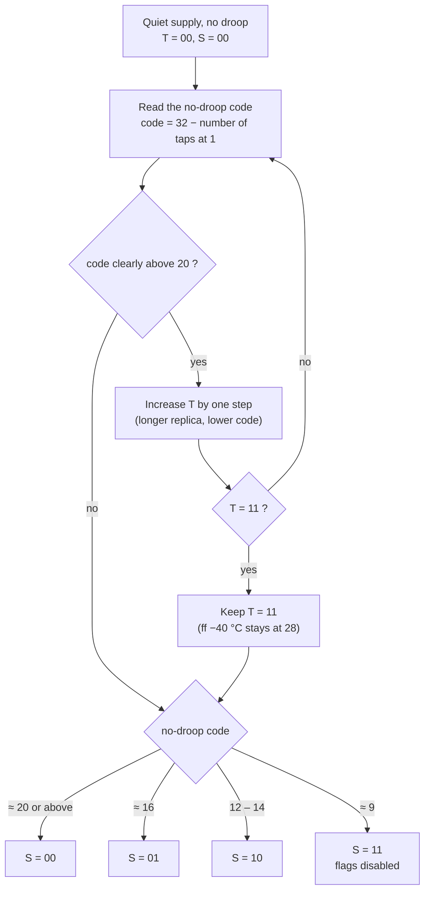

# 7. PVT corners and calibration

[← 6. Results](06-results.md) · [Documentation index](README.md) · Next: [8. Monte Carlo →](08-monte-carlo.md)

A droop monitor that measures delay also measures everything else that changes delay. This chapter shows how much process and temperature move the code, why fixed thresholds fail at 6 of the 15 corners, and how the trim `T` and TAP_CAL's tap select `S` recover most of them.

- [7.1 The 15 corners](#71-the-15-corners)
- [7.2 What sets the code at each corner](#what-sets-the-code-at-each-corner)
- [7.3 Code under droop at every corner](#73-code-under-droop-at-every-corner)
- [7.4 Fixed thresholds vs. TAP_CAL](#74-fixed-thresholds-vs-tap_cal)
- [7.5 Why each failing corner fails](#75-why-each-failing-corner-fails)
- [7.6 The two calibration knobs](#76-the-two-calibration-knobs)
- [7.7 Calibration procedure](#calibration-procedure)
- [7.8 Worst-corner figures of merit](#78-worst-corner-figures-of-merit)

---

## 7.1 The 15 corners

| | −40 °C | 27 °C | 125 °C |
|---|---|---|---|
| **tt** (typical NMOS, typical PMOS) | ✓ | ✓ | ✓ |
| **ff** (fast, fast) | ✓ | ✓ | ✓ |
| **ss** (slow, slow) | ✓ | ✓ | ✓ |
| **fs** (fast NMOS, slow PMOS) | ✓ | ✓ | ✓ |
| **sf** (slow NMOS, fast PMOS) | ✓ | ✓ | ✓ |

All corners: post-layout DVM, 800 MHz, VDD = 1.0 V, single droops of 0, 5, 10 and 15 % (the same raised-cosine stimulus as at TT), run in ADE XL with `T` and `S` set per corner. Data: [`data/ade_xl/corners/`](../data/ade_xl/corners/).

---

## 7.2 What sets the code at each corner

*No droop. (a) TDC stage delay; (b) replica delay with the trim used at that corner, and the clock path; (c) the code predicted by eq. 1 against the simulated code. [`make_corner_timing.py`](../scripts/make_corner_timing.py).*

| Corner | `T` | Stage `t_s` (ps) | `t_TRC` (ps) | Clock path (ps) | Predicted (1278 − `t_TRC`) / `t_s` | Simulated code |
|---|---|---|---|---|---|---|
| ff −40 | 11 | 30.2 | 462.3 | 204.1 | 27.0 | **28** |
| tt −40 | 11 | 37.1 | 571.8 | 253.6 | 19.1 | 18 |
| sf −40 | 11 | 37.2 | 591.1 | 255.7 | 18.5 | 18 |
| fs −40 | 11 | 37.8 | 568.4 | 259.0 | 18.8 | 18 |
| ff 27 | 10 | 39.3 | 491.3 | 258.4 | 20.0 | 20 |
| ss −40 | 00 | 47.2 | 336.7 | 327.6 | 20.0 | 20 |
| **tt 27** | 00 | 47.6 | 325.6 | 316.6 | 20.0 | **20** |
| sf 27 | 00 | 47.9 | 344.8 | 320.3 | 19.5 | 20 |
| fs 27 | 00 | 48.6 | 317.1 | 323.3 | 19.8 | 20 |
| ff 125 | 00 | 55.6 | 367.7 | 355.6 | 16.4 | 16 |
| ss 27 | 00 | 59.8 | 426.6 | 404.1 | 14.3 | 14 |
| tt 125 | 00 | 66.2 | 451.2 | 428.3 | 12.5 | 12 |
| sf 125 | 00 | 66.8 | 478.2 | 435.1 | 12.0 | 12 |
| fs 125 | 00 | 67.4 | 438.6 | 436.3 | 12.5 | 12 |
| ss 125 | 00 | 81.6 | 579.5 | 533.7 | 8.6 | **9** |

Three observations:

1. **One equation explains every corner.** With the window fixed at 1278 ps (the clock period), eq. 1 predicts the code within ±1 everywhere. Nothing else is going on: the code is the number of stage delays that fit after the replica.
2. **Temperature matters as much as process.** tt moves from 20 at 27 °C to 12 at 125 °C. At 125 °C, process spreads the code from 9 (ss) to 16 (ff). fs and sf track tt: every pair of stages has one rising and one falling transition, so a fast NMOS with a slow PMOS roughly averages out.
3. **The stage delay spans 2.7×** across the corners (30 → 82 ps). A delay-based monitor therefore needs per-die calibration; Bowman's DVM has a tunable replica for the same reason.

---

## 7.3 Code under droop at every corner

*Code at the droop bottom (20 ns) for 0 / 5 / 10 / 15 % droop. Gray dashed: fixed DVM thresholds (16 / 12 / 9). Purple: TAP_CAL thresholds for the `S` used at that corner. Green: all four droop levels flagged correctly. [`make_corner_codes.py`](../scripts/make_corner_codes.py).*

| Corner | `S` / `T` | Code at 0 / 5 / 10 / 15 % |
|---|---|---|
| tt / fs / sf 27 | 00 / 00 | 20 / 16 / 12 / 9–10 |
| ff 27 | 00 / 10 | 20 / 16 / 12 / 8 |
| ss −40 | 00 / 00 | 20 / 16 / 10 / 13† |
| tt / fs / sf −40 | 00 / 11 | 18 / 14 / 10 / 7–11† |
| ff −40 | 00 / 11 | 28 / 22 / 18 / 12 |
| ff 125 | 01 / 00 | 16 / 14 / 11 / 10 |
| ss 27 | 10 / 00 | 14 / 10 / 11 / 19 (aliased) |
| tt / fs / sf 125 | 10 / 00 | 12 / 10 / 12–13 / 17 (aliased) |
| ss 125 | 11 / 00 | 9 / 15 / 19 / 9 (aliased throughout) |

† A single snapshot of all 32 taps; at 15 % some corners show a bubble (an edge of the previous window still in the last stages), which distorts the summed code. The flags only use taps 15–24 and are correct at these corners.

**Aliasing.** When the code would fall below about 9, the edge launched in the *previous* window is still travelling through the last stages when the latches open again. The latches then capture a mix of two edges and the code wraps upward instead of falling (tt 125 °C: 12 → 10 → 12 → 17). This is the TDC's range limit, not a threshold problem. A flag is the highest level reached during the run, so at hot corners the flags still fire on the way down, before the code aliases.

---

## 7.4 Fixed thresholds vs. TAP_CAL

Report Table V. Flags at 0 / 5 / 10 / 15 % droop; expected **000 / 100 / 110 / 111**. Bold: wrong.

| Corner (°C) | `S` / `T` | Code | `DVM_O` (fixed taps) | `CAL_O` (TAP_CAL) |
|---|---|---|---|---|
| tt 27 | 00 / 00 | 20 | 000/100/110/111 | 000/100/110/111 |
| fs 27 | 00 / 00 | 20 | 000/100/110/111 | 000/100/110/111 |
| sf 27 | 00 / 00 | 20 | 000/100/110/111 | 000/100/110/111 |
| ff 27 | 00 / 10 | 20 | 000/100/110/111 | 000/100/110/111 |
| ss 27 | 10 / 00 | 14 | **100**/**110**/**111**/111 | 000/100/**111**/111 |
| tt −40 | 00 / 11 | 18 | 000/100/110/111 | 000/100/110/111 |
| fs −40 | 00 / 11 | 18 | 000/100/110/111 | 000/100/110/111 |
| sf −40 | 00 / 11 | 18 | 000/100/110/111 | 000/100/110/111 |
| ff −40 | 00 / 11 | 28 | 000/**000**/**000**/**110** | 000/**000**/**000**/**110** |
| ss −40 | 00 / 00 | 20 | 000/100/110/111 | 000/100/110/111 |
| tt 125 | 10 / 00 | 12 | **110**/**111**/**111**/111 | 000/100/**111**/111 |
| fs 125 | 10 / 00 | 12 | **110**/**111**/**111**/111 | 000/100/**111**/111 |
| sf 125 | 10 / 00 | 12 | **110**/**111**/**111**/111 | 000/100/**111**/111 |
| ff 125 | 01 / 00 | 16 | **100**/100/110/111 | 000/100/110/111 |
| ss 125 | 11 / 00 | 9 | **111**/**111**/**111**/111 | 000/**000**/**000**/**000** |
| **Detected correctly** | | | **41 / 60** | **50 / 60** |
| **False warnings** | | | **16 / 60** | **4 / 60** |
| **Corners flagging with no droop** | | | **6 / 15** | **0 / 15** |

A *false warning* is a flag level above the applied droop. The `DVM_O` column shows the DVM's own fixed taps (`S` only affects TAP_CAL); `T` applies to both because both read the same TDC.

**The scorecard in one sentence:** TAP_CAL removes every no-droop false alarm and grades 5 % correctly at five of the six slow or hot corners (the sixth, ss 125 °C, is disabled on purpose); the errors that remain are TDC range limits (aliasing at slow and hot corners, too high a code at ff −40 °C) that no choice of tap can fix.

---

## 7.5 Why each failing corner fails

| Corner(s) | No-droop code | Fixed taps | TAP_CAL (`S`) | Remaining error | Cause |
|---|---|---|---|---|---|
| ff 125 | 16 | **100**/100/110/111 | 000/100/110/111 (01) | none | the no-droop code sits on the fixed 5 % threshold (≤ 16) |
| ss 27 | 14 | **100/110/111**/111 | 000/100/**111**/111 (10) | 10 % over-graded | code aliases beyond 5 %: 14 → 10 → 11 → 19 |
| tt / fs / sf 125 | 12 | **110/111/111**/111 | 000/100/**111**/111 (10) | 10 % over-graded | same: 12 → 10 → 12 → 17 |
| ss 125 | 9 | **111/111/111**/111 | 000/**000/000/000** (11) | no detection (disabled) | the TDC is out of range even without a droop |
| ff −40 | 28 | 000/**000/000/110** | same (00, `T` = 11) | 5 % and 10 % missed, 15 % under-graded | code too high even with the maximum trim: a 5 % droop only brings it to 22 |

Over-grading a 10 % droop as 15 % is an error on the safe side: the droop is flagged, only its depth is overestimated.

**The race at slow corners.** The baseline decision flip-flop samples on the falling `CLK` edge, 625 ps after the rising edge that starts the hold phase. The latches close only after the clock path (`t_clk2div + t_buf`), and the decision also needs the `clkdivB` inverter, the transmission-gate mux and the flip-flop setup time:

| Corner | Clock path | 625 ps − clock path (before mux, inverter and setup) |
|---|---|---|
| tt 27 | 317 ps | 308 ps (281 ps measured from latch close to the decision edge) |
| ff 125 | 356 ps | 269 ps |
| ss 27 | 404 ps | 221 ps |
| tt 125 | 428 ps | 197 ps |
| ss 125 | 534 ps | 91 ps |

*Clock paths from the corner sweep ([7.2](#what-sets-the-code-at-each-corner)); an earlier run of the same corners, quoted in the report, gave 416 ps at tt 125 °C and 522 ps at ss 125 °C.*

At ss 125 °C almost nothing is left. This showed up while testing `S = 11`: with all inputs tied low, the TAP_CAL flip-flops, then clocked like the baseline, still read 111, so they had never loaded. TAP_CAL was therefore **retimed** to sample on the rising `CLK` edge, at the end of the hold phase, which adds 625 ps of margin; after that `S = 11` reads 000 as it should. The baseline DVM keeps its original timing so that both can be compared in the same run.

---

## 7.6 The two calibration knobs

### `T`: trim the replica (lowers the code)

`T<1:0>` selects 4, 8, 12 or 16 TRC buffers. Schematic, 800 MHz, TT:

| `T` | 00 | 01 | 10 | 11 |
|---|---|---|---|---|
| `t_TRC` | 175.9 ps | 260.3 ps | 345.7 ps | 425.0 ps |

A longer replica leaves less of the window for the TDC, so the code **falls**. That is what a fast or cold die needs: ff 27 °C uses `T = 10`, the cold tt/fs/sf/ff corners use `T = 11`. `T` cannot **raise** the code, because 00 is already the shortest replica, so slow and hot dies need a different fix. Data: [`trc_trim_sweep.csv`](../data/schematic/trc_trim_sweep.csv).

### `S`: move the thresholds (TAP_CAL)

| `S` | Use when the no-droop code is | Taps (5 / 10 / 15 %) | Fires at code ≤ | Corners in this study |
|---|---|---|---|---|
| 00 | ≈ 20 (after `T`) | `O<15>` / `O<19>` / `O<22>` | 16 / 12 / 9 | all 27 °C except ss; all −40 °C |
| 01 | ≈ 16 | `O<17>` / `O<20>` / `O<21>` | 14 / 11 / 10 | ff 125 |
| 10 | 12–14 | `O<21>` / `O<23>` / `O<24>` | 10 / 8 / 7 | tt / fs / sf 125, ss 27 |
| 11 | ≈ 9 (out of range) | VSS | never (disabled) | ss 125 |

The thresholds for `S = 01` and `10` are set by the droop codes at those corners (for example ff 125 °C: 16 → 14 / 11 / 10 at 5 / 10 / 15 %), not by a fixed offset, because the code-per-percent slope shrinks as the stage slows down.

---

## 7.7 Calibration procedure

- **One measurement point per die:** the no-droop code, read with the supply quiet. It is the same TDC output the monitor uses anyway, so no extra hardware is needed.
- **The code groups** (≈ 20 / ≈ 16 / 12–14 / ≈ 9) are those of report Table IV; exactly where to switch between them is a design choice. In this study `T` was raised until the code came down to about 20 or below (20 at ff 27 °C with `T = 10`, 18 at the cold corners with `T = 11`).
- **Temperature.** `S` and `T` were chosen per corner, i.e. per process *and* temperature. Since temperature moves the code as much as process, a chip would need to repeat the reading when its temperature changes a lot. That loop was not designed or simulated here.

---

## 7.8 Worst-corner figures of merit

| Figure | Worst value | Corner |
|---|---|---|
| Active power (DVM) | 202.3 µW (253 fJ per cycle) | ff −40 °C, `T = 11` |
| Detection latency | 4.94 ns (≤ 5 ns spec) | TAP_CAL, ss 27 °C, 10 % |
| Energy per detection | 0.65 pJ | ff −40 °C |
| Leakage | 90.2 nW (112 nW with TAP_CAL) | ff 125 °C |
| Resolution | 25 mV per code | 125 °C |
| Detection levels | 5 % only | hot corners |
| False warnings with no droop | DVM 100, TAP_CAL 000 | ss 27 °C |

Power, energy and latency come from the saved states `state_worst` and `state_ss27`, leakage from `state_leak_worst` ([5.5 Saved ADE L states](05-simulation-setup.md#55-saved-ade-l-states)); resolution and detection levels from the corner sweep.

---

[← 6. Results](06-results.md) · [Documentation index](README.md) · Next: [8. Monte Carlo →](08-monte-carlo.md)
