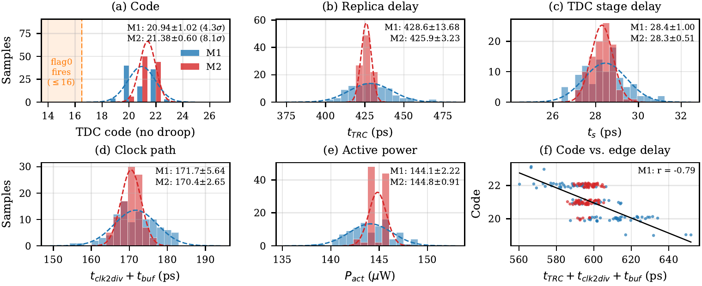

# 8. Monte Carlo

[← 7. PVT and calibration](07-pvt-and-calibration.md) · [Documentation index](README.md) · Next: [9. Design journey →](09-design-journey.md)

Corners show the extremes of the process; Monte Carlo shows the spread a real population of dies would have, and splits it into a **global** part (the whole die is fast or slow) and a **local** part (mismatch between neighbouring transistors). The split decides the remedy: local mismatch shrinks with bigger devices, global variation only with calibration.

- [8.1 Setup](#81-setup)
- [8.2 Results](#82-results)
- [8.3 Global or local?](#83-global-or-local)
- [8.4 What it means for the design](#84-what-it-means-for-the-design)
- [8.5 Limits of this analysis](#85-limits-of-this-analysis)

---

## 8.1 Setup

| | |
|---|---|
| Views | **schematic** (DVM and TAP_CAL) |
| Corner | TT models with statistical variation, 27 °C, V<sub>DD</sub> = 1.0 V, no droop |
| Design point | 1 GHz, `T = 11` |
| Samples | 100, Latin hypercube sampling |
| Runs | **M1**: process + mismatch · **M2**: mismatch only |
| Outputs | no-droop code, `t_TRC`, `t_s`, clock path, active power, the three flag levels |
| Data | [`M1_100_samples.csv`](../data/montecarlo/M1_100_samples.csv), [`M2_100_samples.csv`](../data/montecarlo/M2_100_samples.csv) |

**Why the schematic at 1 GHz with `T = 11`.** Monte Carlo was run on the schematic views. At 800 MHz the faster schematic TDC reads 30–32, at or near saturation ([`trc_trim_sweep.csv`](../data/schematic/trc_trim_sweep.csv)). At 1 GHz with the longest replica the nominal code is 22, inside the TDC range and close to the post-layout operating point (20), so the margins to the flag thresholds are comparable.

---

## 8.2 Results

<p align="center"></p>

*M1 (blue): process + mismatch; M2 (red): mismatch only. Dashed: normal fits. (a) Code with the flag0 region (code ≤ 16); (b)–(e) replica delay, stage delay, clock path, active power; (f) code against the total edge delay. [`make_mc.py`](../scripts/make_mc.py).*

Report Table VI:

| µ ± σ | M1: process + mismatch | M2: mismatch only |
|---|---|---|
| Code (range) | 20.9 ± 1.0 (19–23) | 21.4 ± 0.6 (20–22) |
| `t_TRC` | 428.6 ± 13.7 ps | 425.9 ± 3.2 ps |
| `t_s` | 28.45 ± 1.00 ps | 28.29 ± 0.51 ps |
| Clock path `t_clk2div + t_buf` | 171.7 ± 5.6 ps | 170.4 ± 2.6 ps |
| Active power | 144.1 ± 2.2 µW | 144.8 ± 0.9 µW |
| Highest flag level (any flag, any sample) | 5.7 mV | 4.9 mV |
| Samples with no false flag | **100 / 100** | **100 / 100** |
| Margin to flag0 (µ − 16.5) / σ | **4.3σ** | **8.1σ** |

- **No false flag.** The highest level on any flag in any sample is 5.7 mV, against a 0.5-V logic threshold.
- **Margin.** The nearest code to a false flag0 is 19 (flag0 fires at ≤ 16). In units of the code spread that is 4.3σ with process + mismatch and 8.1σ with mismatch alone.
- **The code histogram is uneven** (M1: 40 samples at 20, 17 at 21, 36 at 22). This is consistent with the alternating wide/narrow codes seen in the DNL ([6. Results](06-results.md#static-transfer-curve-resolution-dnl-inl)): a randomly shifted edge lands more often in a wide code.
- **The code follows the delays.** Across the M1 samples the code falls as the die's edge delay rises (r = −0.79 in panel f), as eq. 1 predicts. Eq. 1 with the M1 means gives (1000 − 428.6) / 28.45 = 20.1, against the simulated mean of 20.9.

---

## 8.3 Global or local?

If the two sources are independent, the M1 variance is the sum of a global and a local part, and M2 measures the local part alone:

```
σ²(M1) = σ²(global) + σ²(local)          σ²(M2) = σ²(local)
global share = 1 − σ²(M2) / σ²(M1)
```

| Quantity | σ (M1) | σ (M2) | Global share of the variance |
|---|---|---|---|
| `t_TRC` (replica, 32 inverters at `T = 11`) | 13.7 ps | 3.2 ps | **94 %** |
| Clock path | 5.6 ps | 2.6 ps | 78 % |
| Power | 2.2 µW | 0.9 µW | 83 % |
| `t_s` (one TDC stage, averaged over the chain) | 1.00 ps | 0.51 ps | 74 % |
| Code | 1.02 | 0.60 | 66 % |

*The clock-path share is computed here from the same data; the other four are in the report.*

**Why the replica is almost all global.** A chain of N stages adds the *global* shift N times (every stage moves the same way), but independent *local* mismatch adds only as √N. Relative to its mean, the local part of a long chain therefore shrinks as 1/√N while the global part does not. The replica at `T = 11` is 16 buffers (32 inverters), so its local part averages out almost completely. In M1 the replica and stage delays move together (correlation 0.82: the whole die is fast or slow); in M2 they are uncorrelated (−0.03), as independent mismatch should be.

**Why the code is less global (66 %).** Most of the code's spread comes from the stage delay (about 21 stages × σ(`t_s`) ≈ 21 ps in M1, against 13.7 ps from the replica), and `t_s` is only 74 % global. Rounding to an integer code also adds the same spread to both runs, which counts as "local" in this split.

---

## 8.4 What it means for the design

| Observation | Consequence |
|---|---|
| Global process dominates the replica and the code | per-die calibration (`T`, `S`) is the right remedy |
| Local mismatch is small (code σ = 0.6 with mismatch only) | upsizing devices would cost area and power for little gain: by Pelgrom's law, σ(ΔV<sub>T</sub>) ∝ 1/√(W·L), so halving the local spread needs 4× the gate area |
| Matching layout (common centroid, dummies) | would also only address the local part; not used ([4.5](04-layout-and-extraction.md#45-layout-practices-and-their-limits)) |
| Code spread σ ≈ 1 at TT vs. 9–28 across corners | the corners, with temperature, are the real problem for the fixed thresholds; Monte Carlo at one temperature is comfortable |

---

## 8.5 Limits of this analysis

- **Schematic only.** Layout parasitics are not included; they slow every stage by a similar factor, so the *relative* spread should be similar, but this was not simulated.
- **No droop.** The runs check false alarms and margins, not detection of a droop under variation.
- **One temperature (27 °C).**
- **100 samples.** With 0 failures in 100 samples the failure rate is below about 3 % with 95 % confidence ("rule of three", 3 / n). The 4.3σ margin, assuming a normal distribution, suggests a much lower rate, but 100 samples cannot prove it.

---

[← 7. PVT and calibration](07-pvt-and-calibration.md) · [Documentation index](README.md) · Next: [9. Design journey →](09-design-journey.md)
