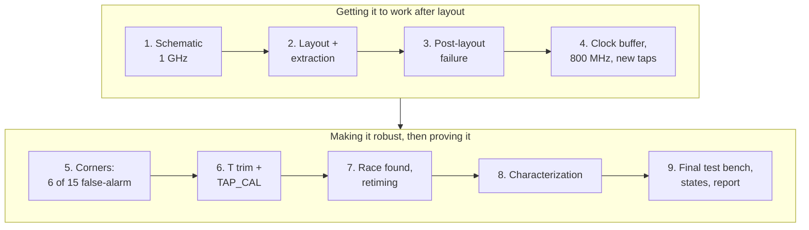

# 9. Design journey and lessons learned

[← 8. Monte Carlo](08-monte-carlo.md) · [Documentation index](README.md) · Next: [10. FAQ →](10-faq.md)

The final design is not the first one. This chapter tells how it got there: what broke, how each problem was found, and what it taught us. Most of the interesting engineering in this project happened between "the schematic works" and "the extracted layout works across corners".

---

## Phase 1: schematic at 1 GHz

- Built Bowman's architecture from full-custom cells: divider, tunable replica (16 buffers + 4:1 mux), 32-stage latch TDC, three decision stages. The 1-GHz clock was our own choice, not a course requirement.
- A stand-alone TDC reached 7 / 11 / 15 stages in 200 / 300 / 400-ps windows: **25.0 ps per stage**, κ = 3.0 against Bowman's 1.4, because each chain inverter also drives a latch transmission gate.
- The first taps were `O<12>` / `O<18>` / `O<22>`.
- The schematic met every target: 143.9 µW, 144 fJ per cycle, a 10 % droop flagged after 3.31 ns. These became the pre-layout column of the figure-of-merit table.

## Phase 2–3: layout, extraction, and the first post-layout run

Every cell, then TRC, TDC and DVM, was laid out, DRC-cleaned, LVS-matched and RC-extracted. The first post-layout simulation kept the schematic design point (1 GHz, no clock buffer) and failed:

| Symptom | Cause found |
|---|---|
| Two flags high with no droop | the TDC reached too few stages in the window |
| Latch clock (`clkdiv`) triangular instead of square | the divider flip-flop was driving 32 latch enables, the TRC input and their wiring by itself |
| No droop level flagged correctly | both of the above |
| TDC stage 47 ps instead of 27 ps | wiring between the stages (the FO1 inverter alone slowed only 1.29×) |

## Phase 4: three fixes

1. **Clock buffer.** A 4× and a 16× inverter between the divider and `clkdiv_b`. The latch clock became a clean edge (63.6-ps rise).
2. **800 MHz instead of 1 GHz.** With the buffer the 1-GHz design still raised the 5 % flag without a droop: 1 ns holds too few 47-ps stages after the replica. A 1.25-ns window gives a no-droop code of 20 with room on both sides.
3. **New taps.** Static supply points at 1.0 / 0.95 / 0.90 V gave codes 20 / 16 / 12 (about 9 at 0.85 V, the edge of the range), so the taps moved to `O<15>`, `O<19>`, `O<22>`. Flags at the four points: 000 / 100 / 110 / 111. The layout was re-wired, LVS re-checked and the DVM re-extracted.

Result: no false flag, all three levels flagged. The full before/after numbers are in [6. Results](06-results.md#recovering-the-post-layout-design).

## Phase 5: corners break the fixed thresholds

Fifteen corners (5 process × 3 temperatures, no droop):

- **6 of 15 corners raised flags without a droop**: all five 125 °C corners and ss 27 °C, because a slow die looks exactly like a drooped supply to a delay sensor.
- The fast, cold corners read too **high** a code, so small droops would be missed.
- Temperature moved the code as much as process did; fs and sf behaved like tt.
- Under droop at hot corners the code stopped falling after 5 % and then aliased, so only one level could be resolved there.

The TRC trim `T` fixed the fast side (ff 27 °C with `T = 10` reads 20 again), but it can only lengthen the replica, i.e. only **lower** the code. The slow side needed something else.

## Phase 6: TAP_CAL

Instead of moving the code, move the thresholds: three 4:1 muxes choose, per die, which TDC taps drive the three flags (`S<1:0>`), with a copy of the decision stage behind each. It was built as a **separate block** so that the original DVM and its flags stay untouched and both can be compared in the same run.

Testing it across corners found four problems in the first version:

| Finding | Fix |
|---|---|
| One corner run used the wrong `S` | rerun with the `S` from the table (a setup slip, not a design issue) |
| The `S = 11` row (taps `O<24>`–`O<26>`) still fired at ss 125 °C: the taps there are aliased | tie the fourth mux input to VSS: `S = 11` now means "flags disabled" |
| At the 125 °C corners (code 12) tap `O<20>` fired one code earlier than the rule predicts | the `S = 10` 5 % tap moved from `O<20>` to `O<21>` |
| With all inputs tied low, the flip-flops **still** output 111 | see Phase 7 |

## Phase 7: the race nobody was looking for

A flip-flop whose input is tied low and still reads 1 has never loaded. The baseline decision stage samples on the falling `CLK` edge, 625 ps after the `CLK` edge that closes the latches, but at ss 125 °C the clock path alone takes over 500 ps, before the mux, the inverter and the flip-flop setup. The TAP_CAL flip-flops were **retimed to the rising `CLK` edge** (end of the hold phase): +625 ps of margin for about 0.5 ns of extra latency. After retiming `S = 11` read 000. The DVM baseline kept its original timing; its margin is 281 ps at TT and only 91 ps at the bottom of a 15 % droop ([timing diagram](02-architecture.md#24-time-to-digital-converter-tdc)).

Final corner result: correct detections **41 → 50 of 60**, false warnings **16 → 4 of 60**, **no corner flags without a droop** ([7. PVT and calibration](07-pvt-and-calibration.md)).

## Phase 8: characterization

| Experiment | Question it answers |
|---|---|
| Static sweep in 2.5-mV steps | resolution, DNL / INL, where each flag switches |
| Single droops 5 / 10 / 15 % with all 32 taps saved | latency, energy per detection, what happens inside the TDC |
| Six-droop trains (TT and ff 125 °C) | does it grade realistic, back-to-back events; does TAP_CAL stay quiet between them |
| 40-droop detection map | how short a droop can be and still be graded |
| V-shaped droops at two sampling phases | shortest flagged droop |
| Monte Carlo, 100 samples, process + mismatch and mismatch only | false-alarm margin; global vs local variation |
| Clock stopped | leakage |
| Extracted FO1 inverter and buffer | how much of the slow-down is the cells and how much the wiring |
| TAP_CAL layout, LVS, extraction | TAP_CAL as a real block, not only a schematic |

## Phase 9: one test bench, saved states, the report

The verification cell was rebuilt so that the whole result set can be reproduced from one place: `DVM_TOP` holds only the test bench and the design under test, a `config` view binds both blocks to their extracted views, and eight saved ADE L states give every post-layout and worst-corner figure of merit ([5. Simulation setup](05-simulation-setup.md)). Re-running everything on this bench caught a few problems of its own:

| Problem | How it was caught |
|---|---|
| One sweep block of a corner run silently applied no droop | its outputs were identical to the no-droop block; `droop_true` is now checked in every run |
| The 0-V probe measured the test bench's clock drivers too (181 µW) | switched to the DVM's own supply terminal: **138.4 µW** |
| Parametric sweeps are not stored in ADE L states | the sweep is written into each state's description |
| A Virtuoso crash lost an unsaved state | states are saved before they are run |

---

## Lessons learned

| # | Lesson | Where it came from |
|---|---|---|
| 1 | **Check high-fanout clock nets first after extraction.** A clock that drives 30+ loads plus wiring needs a buffer, and its edge rate is the first thing to look at. | triangular `clkdiv` |
| 2 | **Wiring, not the cell, dominates small delays after layout.** The FO1 inverter slowed 1.29×, the TDC stage 1.75×. | κ: 3.0 → 4.4 |
| 3 | **Re-choose the operating point instead of forcing the old one.** 800 MHz with new taps fixed what no single sizing change would have. | Phase 4 |
| 4 | **A delay sensor cannot tell a slow die from a drooped supply.** Plan per-die calibration from the start. | 6 of 15 corners false-alarm |
| 5 | **Calibrate where the variation is global.** Monte Carlo put 94 % of the replica's variance in global process; bigger devices would not help. | [8. Monte Carlo](08-monte-carlo.md) |
| 6 | **Test the "off" state.** Tying the inputs low exposed a timing race that every passing test had hidden. | `S = 11` read 111 |
| 7 | **Check timing at the slowest corner, under droop.** A margin of 281 ps at TT became 91 ps at a 15 % droop and too little at ss 125 °C. | retiming |
| 8 | **Measure on transistor-level nets.** Early debugging used a behavioural code reader; every reported number is measured on transistor nets (code from the latch voltages, flags from the decision flip-flops, power at the block terminal). | final test bench |
| 9 | **Verify the stimulus in every run.** A sweep that does nothing looks like a perfectly robust design. | `droop_true` |
| 10 | **Measure power at the block's own terminal.** A probe on the shared supply also counts the test bench. | 181 → 138.4 µW |

## If we continued

- Move each tap one code earlier, so that droops shorter than 8 ns are graded fully.
- Size the TDC inverter for equal rise and fall delay to even out the 60 / 28-ps steps (DNL).
- A longer or faster TDC, or a coarse/fine (two-level) TDC, to remove the hot-corner floor and the aliasing.
- Buffer the TAP_CAL taps so it loads the TDC less.
- A small state machine that re-reads the no-droop code and updates `S` and `T` as the temperature changes.
- Monte Carlo on the extracted views and under droop.
- Use the full 32-tap code, not only three flags, for closed-loop adaptive clocking.

---

[← 8. Monte Carlo](08-monte-carlo.md) · [Documentation index](README.md) · Next: [10. FAQ →](10-faq.md)
